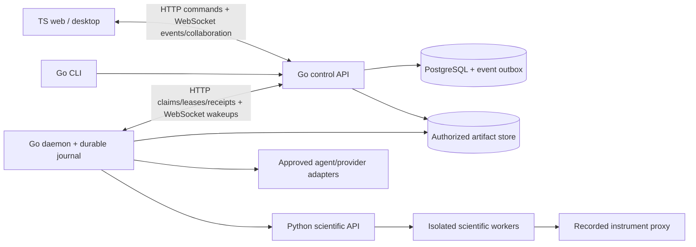

# Lykeion backend, daemon and scientific API contracts

Version 0.2 · 12 October 2026 · design contract, not an implemented service.

Authority: [product specification v0.2](scientific-workflow.md). Delivery order: [implementation plan](../plans/backend-implementation.md). This document replaces the provisional endpoint design in `frontend-api.md` for the fresh backend. The running desktop remains the interaction reference; its existing endpoint names, generic issue semantics and source architecture are not copied.

## 1. Service boundaries and selected architecture

| Boundary | Responsibility | Excluded authority |
| --- | --- | --- |
| Public Go control API `/v1` | Identity, programmes, commands, planning, budgets, artifacts, dependency state, policy evaluation, accepted claims/releases, decisions and event delivery | Does not run arbitrary scientific code in the HTTP process |
| Go daemon control protocol `/worker/v1` | Enrollment, capabilities, claims, fenced leases, attempt receipts, resumable uploads and reconciliation | Cannot select funding order, approve evidence or move cards |
| Python scientific API `/science/v1` | Retrieval adapters, dataset/method feasibility, statistical analysis, reproducibility, report verification, frozen instrument execution and optional jev classification adapter | Cannot write authoritative gates, allocate programme money, publish claims or advance cards |
| Local Go daemon IPC | Desktop/CLI enrollment handoff, local status, authorized artifact export/open, execution control | No arbitrary renderer shell command or filesystem access |
| TypeScript web/desktop and Go CLI | Read models and explicit domain commands | Cannot create system events, manufacture runtime health or assert accepted scientific state |

Start as a modular Go control service, a separately supervised Go daemon, and a Python scientific service/worker package. Avoid distributing database transactions across new microservices. PostgreSQL is the proposed authoritative store for control state, command idempotency, work queue, budget ledger and transactional event outbox. Store artifact bytes in a content-addressed filesystem locally or object storage remotely behind the same authorization interface. SQLite is proposed only for each daemon's local durable journal/outbox; workspace members share authoritative state through Go/PostgreSQL, never a shared SQLite file. Python may persist its own technical job/checkpoint index; that is not a second scientific authority.

Use Go HTTP handlers and domain services with explicit transaction boundaries; Python FastAPI/Pydantic is the proposed typed scientific API implementation. Pin dependencies/toolchains during S00, not from a moving `latest`. OpenAPI 3.1 and shared JSON Schema define transport contracts; generate clients instead of hand-maintaining three diverging type sets. These are implementation selections to validate in S00, not changes to scientific rules.

Public clients connect to Go. Go dispatches authorized work to a daemon; the daemon invokes its local Python service or an approved remote science runtime. A web user can use a remote daemon without a desktop. A local deployment runs the same control semantics. Running the installed reference app does not make it a dependency of the finished product.



## 2. jev integration: model classification versus rule evaluation

The [TypeSafe introduction](https://docs.typesafe.ai/introduction) describes jev as a model returning typed choices/scores and distributions, with composition performed in application code. It does not establish deterministic gate replay. Therefore the proposed **jev gate boundary** comprises:

1. Optional policy-defined classification, performed through the jev adapter and sealed as an artifact with model/question/version/input references.
2. Deterministic Go policy evaluation over recorded classifications, mechanical checks, independent verdicts and captured operational state.
3. Atomic Go enforcement against current revisions, reservations and capacity.

Replay never invokes the model. Lead prose is not a gate input. Policy evaluation returns only `advance`, `block`, `route`, `escalate` and rule IDs. A provider choice never directly moves a card. This binding must be explicitly reviewed at S00 because the product calls the router jev while the provider is not itself a deterministic rules engine. No silent fallback or invented provider guarantee.

## 3. Common transport contract

### Scope, identity and versioning

Read paths are explicitly workspace-scoped: `/v1/workspaces/{workspace_id}/…`. Resource IDs are opaque strings, never bearer capabilities. Authorization is checked on each resource/ref, including content-addressed blobs, nested dependencies, counts and search results. Browser sessions use secure HttpOnly cookies, CSRF protection on mutations and explicit origins. CLI uses scoped revocable credentials; desktop credentials remain in main-process/OS storage behind a narrow bridge. Local installation still requires authenticated pairing; loopback and an `Origin: null` file renderer are not identities.

Use dedicated browser-session, CLI/device and worker credentials; never give the daemon a user's unrestricted token. Server derives actor identity and human/agent/service class from authenticated credentials, not payload fields. Python receives short-lived job-scoped capabilities bound to a manifest, role, lease and data class. No provider keys in frontend storage, event bodies or generated code.

Every response has `schema_version`. Versioned records expose a decimal-string `revision` and an ETag. Use string revisions/cursors to avoid JS integer overflow. Timestamps are UTC RFC3339; user scheduling retains IANA timezone and DST policy. Money uses integer micro-units represented as decimal strings with currency; compute uses explicit units; elapsed deadlines are not money.

`GET /v1/capabilities` returns API/protocol versions, enabled features, compatible client ranges and per-action availability. Unknown versions fail visibly; additive optional fields may be tolerated only under a declared reader policy. Unknown enums are never interpreted as accepted evidence. Server-side transition restrictions apply regardless of client version.

### Commands

All domain mutations use `POST /v1/workspaces/{workspace_id}/commands/{command_name}`. Only the names listed in this document exist; no generic action execution, resource mutation or arbitrary script endpoint. A URL command has its own typed payload schema and authorization handler. Clients, drag shortcuts, CLI and agents call the same handler.

```json
{
  "schema_version": "1",
  "target": {"kind": "inquiry", "id": "inq_example"},
  "expected_versions": [{"kind":"inquiry","id":"inq_example","revision":"7"}],
  "payload": {"destination":"Hypotheses","candidate_manifest_ref":{"id":"manifest_example","revision":"1","sha256":"…"}}
}
```

Required header: `Idempotency-Key`, scoped by workspace, authenticated principal and command name. The server stores a canonical request hash with the receipt; identical replay returns the original receipt, different payload with the same key returns `409 IDEMPOTENCY_MISMATCH`. Keep receipt/tombstone retention at least as long as permitted replay; never silently treat an expired key as a new scientific execution. Unknown fields in command payloads are rejected. New records use their parent workspace/programme as target and receive server-generated IDs. Existing-record commands require expected versions of all mutable aggregate roots listed in their command contract; the server additionally checks dependent policy/input versions.

Domain commands return `202 Operation` after durable acceptance, including short commands; acceptance means queued for processing, not scientifically accepted. Reads return `200 Read<T>`; lists return `200 Page<T>`.

```text
Operation = schema_version, id, command_name, state(queued|running|succeeded|blocked|failed|superseded),
            target_ref, accepted_at, result_refs[], decision_ref?, failure?, event_cursor
Read<T> = schema_version, data:T, event_cursor
Page<T> = schema_version, items:T[], next_cursor?, snapshot_revision, event_cursor
Problem = schema_version, code, message, request_id, retryable, violations[], current_versions[]
```

`GET /v1/workspaces/{w}/operations/{id}` returns the receipt. `result_refs` resolve typed resources; a transition `block` can be a successfully completed evaluation with an unchanged card. Do not confuse operation state with the scientific gate decision or attempt terminal state. Error responses use `application/problem+json`, retaining HTTP semantics: 400 malformed, 401 authentication, 403 authority, 404 inaccessible/missing, 409 version/idempotency conflict, 422 invalid domain input, 429 intake rate cap, 503 unavailable dependency. A valid gate rejection is a decision receipt, not an HTTP server failure.

A human confirmation uses `decision.respond` with the exact decision version and structured choice. Creating a command does not confer human authority. Compound operations (request transfer and owner stop, budget reservation and dispatch, release and Done) are atomic domain transactions, not multiple best-effort UI calls.

### Reads, pagination and events

All list endpoints accept opaque `cursor`, bounded `limit`, allowlisted filters and stable sort; no arbitrary query language. `Page` cursors pin a query/snapshot context, and access is rechecked per page. Secret/blinded data must not leak through totals, suggestions, previews or relevance ranking. Expired snapshots return `409 SNAPSHOT_EXPIRED` with refresh instructions.

WebSocket is the primary workspace realtime transport: `GET /v1/workspaces/{w}/realtime` upgrades to subprotocol `lykeion.workspace.v1`. Durable domain commands still use HTTP. One connection per active workspace/client session multiplexes authorized subscriptions, presence and document synchronization; no second mandatory SSE connection. `GET /v1/workspaces/{w}/events?after={cursor}` is a paginated JSON replay/catch-up endpoint, not SSE. If WebSocket is unavailable, HTTP commands and event catch-up continue; presence and live coediting show a degraded state rather than fake connectivity.

Durable event fields: `id`, `type`, `subject_ref`, `revision`, `recorded_at`, `operation_id`, authorized minimal `payload`, `causation_id`, `correlation_id`, `attribution_ref`. Snapshot reads include a high-water cursor. Subscribe from that cursor, then apply buffered events newer than the snapshot; deduplicate by event ID. Cursors are opaque and scoped to principal/workspace/filter/authorization epoch, not raw global sequence numbers. Expired cursors or changed access require an authorized fresh snapshot. Replay applies current access and scientific blinding, even when the actor previously saw an event.

Database transactions write state and outbox together; publication is at least once. Go realtime instances consume a durable event log and use an internal fan-out interface for low-latency hints. The initial PostgreSQL-backed adapter uses wake notifications plus periodic outbox catch-up; notification loss is harmless and no scientific state lives only in a broker. Each instance serves its own connected clients from committed events. A future broker adapter must preserve this contract; no mandatory Redis dependency is inferred from Multica's library list. Multi-instance clients do not require sticky sessions for correctness.

Client projections invalidate/refetch affected read models. Durable event lag and bounded per-connection queues are monitored. Slow consumers receive `resync_required` and reconnect rather than growing an unbounded buffer or silently losing scientific events. Ephemeral presence may be coalesced/dropped and is never replayed as history. At-least-once delivery with unique settlements/acceptance roots provides one committed effect, not exactly-once networking. WebSocket framing follows [RFC 6455](https://www.rfc-editor.org/rfc/rfc6455); application replay, authorization and persistence are Lykeion responsibilities.

### WebSocket handshake and message contract

Web browser upgrades require an authenticated secure session, an explicit Origin allowlist and current workspace membership. Cross-site upgrades are rejected; CORS is not the WebSocket authorization mechanism. Desktop uses its authenticated main-process bridge; worker sockets use separate machine credentials. Never put persistent credentials in URLs. Session expiry closes the socket and requires reauthentication. Check access at subscription, each inbound action and each outbound delivery; removal invalidates all affected connections and cached workspace projections. Each delivery checks the committed authorization epoch, rather than trusting an eventually delivered revocation hint; already in-flight bytes cannot be recalled. Already downloaded bytes cannot be retroactively erased, so export and retention policy still apply.

All frames use `schema_version`, `type`, `message_id`, `subscription_id?`, `payload`; server frames may include `reply_to`, `cursor`, `revision`. Closed message enums, frame size/rate limits, heartbeat timeouts, reconnect jitter and protocol negotiation are frozen in S00. A heartbeat proves connection liveness only; it neither renews an execution lease nor confers scientific authority.

| Frame type | Direction | Payload / semantics |
| --- | --- | --- |
| subscribe | client → server | authorized subject/channel filters, after_cursor?; server captures high-water mark and catches up before live delivery |
| subscribed | server → client | subscription_id, accepted filters, high_water_cursor, authorization_epoch |
| unsubscribe | client → server | subscription_id; clears associated ephemeral presence |
| event | server → client | committed durable event; duplicates allowed, version-aware client application required |
| ack | client → server | last contiguous applied cursor; delivery checkpoint only, never scientific acceptance |
| presence.update | client → server | document/session subject, viewing/editing/typing state, revision-anchored selection?; identity supplied by server, not caller |
| presence.snapshot | server → client | authorized participants, session IDs, expiry times; no hidden-document membership leakage |
| presence.changed | server → client | participant delta with expiry; connection loss eventually removes presence |
| document.sync | client → server | document_id, known_revision; read-only catch-up request |
| document.snapshot | server → client | authorized draft revision/content reference and edit-log cursor; no implicit write grant |
| document.changed | server → client | committed document edit/revision and originating operation ID; exact same revision as HTTP command result |
| resync_required | server → client | reason, scoped snapshot/replay link; discard incompatible projection and reload |
| error | server → client | Problem-compatible code, reply_to, retryability; forbidden subjects do not expose existence |

Document edits use `document.apply-edit` over HTTP; WebSocket distributes committed edits and live cursor/presence updates. This retains one durable mutation path and idempotency contract while allowing simultaneous authors. Selection/cursor frames contain no document text and are bounded; presence is not a lock, grant, assignment or review verdict. A person may have several sessions; expiry removes the session and removes their visible presence only when none remain.

## 4. Core resource shapes

These are API projections of the logical records in the product spec. Domain artifacts retain their exact schema/version; clients do not flatten provenance into comments.

| Read model | Required fields beyond identity/revision |
| --- | --- |
| Workspace / Membership | workspace policy and owner refs / user_id, workspace_id, access_role, state, grant_refs, authorization_epoch; user membership distinct from scientific role assignment |
| CollaborationSession | subject_ref, visibility/access policy, participants with capabilities, document_revision, transient presence; accepted artifacts remain immutable |
| Programme | objective, profile_ref, policy_refs, owner, lead_role_id, budget_summary, WIP limits, escalation cap, sharing policy, data/remote policy |
| InquiryCard | programme_id, question_ref, title, column, stage?, lead_role_id, operational_states with reasons, primary_overlay, cycle_count, admission, funding, gate_ref?, request dependencies, outcome?, claim_counts, outcome_explanation_ref? |
| RequestCard | owner_scope, consumers with blocked subject refs, acceptance_ref, working_column, allocation_ref, deadline, ownership_history, accepted_result_ref?, operational_states |
| Board | programme_ref, columns with total/blocked/waiting counts, cards page, WIP policy, bottlenecks, caller-permitted actions |
| ActionAvailability | command_name, enabled, reason_code?, required_version_refs, decision_needed?; advisory to UI, never an authorization token |
| GateDecision | subject/input manifest refs, policy/evaluator refs, check/verdict/classification refs, decision, route_target?, missing_items[], rule_ids[], canonical_input_hash, replay_hash |
| BudgetSummary | per-dimension ceiling, available allocation, committed, spent, review/report reserve, current-step floor, outstanding obligations, ledger_cursor |
| Attempt | work_id, trial_id, attempt_id, phase, configuration_ref/hash, role_id, contract/input/environment refs, runtime_class, lease_ref, terminal receipt?, checkpoint_ref?, outputs, actual use, accounting disposition |
| Role / Configuration | permissions/responsibility / immutable model+instructions+skills+tools+access manifest; approved binding refs remain separate |
| ArtifactManifest | entries(path, blob ref, bytes, media type, hash), input refs, inherited data class, authored/produced kind, producing attempt, seal receipt, acceptance refs |
| DecisionItem | subject and policy refs, structured choices, responder eligibility, deadline/action, adjacent-work cap, state, response ref, supersedes/incident refs |
| KnowledgeHit | accepted ref, status/scope, root/shared-input refs, supporting/challenging/mandatory group, restrictions, importable and reason; diagnostic hits use a distinct type with importable=false |
| QuickSession | selected role/configuration, mode, allowance, messages/document revisions, attempt refs, source refs, pending cross-mode confirmation, promotion link |
| Release | manifest/audit/ledger refs, outcome + counts/explanation, prior release/erratum, publication and retraction state |

No inquiry PATCH accepts column, gate decision, accepted claim status, runtime health or budget settlement. No generic `parentId` converts an inquiry into a request. Spawned/continues links and shared request dependencies have separate types.

## 5. Feature command and read catalogue

Payload fields below are required unless suffixed `?`. Common envelope, idempotency, expected revisions, principal authorization and result refs apply throughout. `Ref` means an exact immutable reference; `Scope` means an authorized workspace/programme/inquiry/request/session identity. `draft_ref` pins a typed submitted draft, not an arbitrary mutable path. A proposal-producing command does not imply approval. Generated OpenAPI must expand these named records and reject undeclared fields before implementation of that slice.

### F01 Programmes, identity and access

Reads: `GET /v1/session`, `/v1/capabilities`, `/v1/workspaces`; workspace-relative `/programmes`, `/programmes/{id}`, `/members`, `/invitations`, `/access-grants`, `/me/preferences`. Invitation acceptance uses the authenticated account route `POST /v1/invitations/{id}/accept` with a one-time invite proof, Idempotency-Key and invitation revision because the recipient is not a workspace member yet; response is an Operation accessible to that recipient at `GET /v1/me/operations/{id}` without revealing workspace data before acceptance. The proof is not retained in events.

| Command | Payload | Authority / result / events |
| --- | --- | --- |
| programme.create | name, objective, profile_ref, initial_policy_refs, budget_ceiling | Human owner; Programme + initial ledger; programme.created |
| programme.amend-objective | objective_ref, reason | Owner or explicitly authorized human; versioned objective; programme.objective_changed |
| programme.propose-policy | prior_policy_ref, candidate_ref, impact_classification_ref | Eligible proposer; DecisionItem, never active policy |
| programme.apply-policy | approved_decision_ref, candidate_ref | Control service verifies exact approval; policy version + reassessment; policy.activated |
| member.invite | destination, requested_role, expires_at | Authorized human; invitation delivery requires explicit user intent; membership not active until acceptance |
| member.request-access-change | member_id, requested_access, expires_at | Owner/admin requests a pinned membership decision; requesting alone changes no access |
| workspace.request-owner-transfer | recipient_member_id, expires_at | Current owner requests acceptance by the named active member; the requester cannot accept for them |
| member.change-access | member_id, requested_access, approved_decision_ref | Human-authorized expansion; access/stream invalidation events |
| invitation.revoke | invitation_id, reason | Authorized workspace administrator; unused proof becomes invalid |
| member.remove | member_id, ownership_handoff_ref?, reason | Authorized administrator; revoke grants/subscriptions and re-evaluate attributed active work; preserve authorship/history |
| member.leave | ownership_handoff_ref? | Current member; same last-owner and outstanding responsibility checks as removal |
| workspace.transfer-owner | recipient_member_id, acceptance_decision_ref | Current owner and accepting human; atomic transfer; cannot remove the last owner |
| access.change | subject_ref, grant_changes_ref, approved_decision_ref? | Authorized owner/admin under policy; expansion requires human authority; no access beyond parent constraints |
| preference.update | preference_kind, value | Current human; presentation settings only; preference.changed |

Authentication login/callback/logout/device authorization routes are provider-specific adapters selected in S00. Publish their schemas then; never expose a bootstrap-owner endpoint beyond authenticated installation setup. API token issuance uses `credential.issue` with approved decision, scopes and expiry; return the secret once through a credential-specific response/secure channel, never an operation event or reusable receipt. `credential.revoke` targets its ID. Enrollment credentials are separate.

S01 installation-account binding: `member.invite.destination` is the exact installation user ID until a verified-email delivery adapter exists. The creator can retrieve the pending proof through `GET /v1/workspaces/{w}/invitations/{id}/proof`; no proof appears in receipts, events or diagnostics. This is manual private handoff, not email delivery. Invitations expire within a caller-selected period of at most 30 days. Only an owner can invite administrators. Requesting, accepting, revoking and consuming a proof are serialized under the workspace lock.

Membership decisions are read at `/membership-decisions`, scoped to the requester or responder. The S01 `decision.respond` wire subset accepts only these membership decisions, with an exact decision revision, `approve` or `reject`, and pinned workspace/membership subject versions. Access changes require the authorized administrator's structured response; ownership transfer requires the recipient's. The successful response atomically applies the previously authorized effect and records its receipt. `member.change-access` and `workspace.transfer-owner` are internal effects of this response in S01, not independently callable bypasses. Expired, consumed or changed subjects cannot be approved. Scientific decision types remain unavailable until their S02 authority is implemented.

Colleagues is the canonical membership-management page. Preserve its existing introduction and compact colleague rows; add invitation, access-decision and leave controls within that page. The sidebar label and route remain **Colleagues** and `/colleagues`. No separate Members navigation item is introduced. Rows show actual account roles; absent verified email is not fabricated.

### F02–F04 Inquiries, shared requests, board and planning

Reads: `/programmes/{id}/board`, `/inquiries`, `/inquiries/{id}`, `/inquiries/{id}/history`, `/requests`, `/requests/{id}`, `/programmes/{id}/planning`, `/programmes/{id}/admission-queue`, `/me/needs-attention`. Board filters cover layout, lead role, column, operational state, priority and dates.

| Command | Payload | Authority / result / events |
| --- | --- | --- |
| inquiry.propose | programme_id, question_ref, title, metadata, origin_ref?, changed_circumstances_ref? | Human/approved agent/template; Backlog card; inquiry.proposed. Agent rate limit applies. |
| inquiry.edit-metadata | title?, priority?, labels?, dates? | Authorized actor; only non-scientific metadata; inquiry.metadata_changed |
| inquiry.admit | candidate_ref, readiness_refs | Admission service; jev receipt; inquiry.eligibility_changed. No dispatch. |
| inquiry.select | admission_ref, planning_ref, requested_allocation, initial_work_ref | Programme lead; atomic reserve/floor/WIP validation; inquiry.funded then work.queued |
| inquiry.priority-signal | before_card_id?, after_card_id?, column | Human; recorded signal and lead-response obligation; never allocation |
| lead.record-plan | scope, prior_state_ref?, plan_manifest_ref, open_decision_refs, last_route_ref? | Assigned lead; durable versioned lead state, no gate or funding authority |
| inquiry.assign-role | lead_role_id, reason | Programme authority; no configuration privilege escalation |
| inquiry.request-transition | destination, candidate_manifest_ref, evidence_refs | Lead/human shortcut; gate evaluation operation, pending in place |
| inquiry.request-route | destination, reason_code, amendment_ref?, evidence_refs | Authorized requester; evaluate route/amendment rules, not raw position edit |
| inquiry.pause | reason, pause_policy_ref | Authorized actor; pause deadline, dispatch stop; inquiry.paused |
| inquiry.preview-park | reason | Read-like command; consequence receipt bound to current versions |
| inquiry.park | consequence_ref, confirmed:true | Human confirmation or preapproved deadline service; release allowed funds, preserve obligations |
| inquiry.request-stop | reason_code, evidence_refs, ownership_transfer_ref? | Programme lead/human; closure workflow or human decision, never force Done |
| inquiry.continue | stopped_inquiry_ref, changed_scope_ref | New Backlog inquiry linked continues; original stays stopped |
| request.propose | owner_scope, consumer_refs, ask_ref, acceptance_ref, allocation, dedup_key | Lead; match existing request or create owned request; request.consumer_attached/created |
| request.attach-consumer | request_ref, blocked_subject_ref, import_requirement_ref | Consumer lead; does not change acceptance/funding |
| request.amend | acceptance_ref, rationale_ref, budget_adjustment_ref, approval_ref? | Owner under amendment rules; affected consumers notified |
| request.transfer | new_owner_scope, funding_transfer_ref, decision_ref? | Programme authority; atomic ownership/funding handoff |
| request.complete | result_manifest_ref, check_refs, review_refs | jev/control acceptance; knowledge item + Done request; no automatic dossier imports |

Relation creation checks for dependency cycles. Request dedup is serialized on exact dedup keys; semantic matching is recorded as a proposal/classification, never silent merging of different acceptance criteria. End-to-end selection locks programme budget/WIP and inquiry revisions in a documented order.

### F05–F07 Roles, configurations, reviews and jev gates

Reads: `/roles`, `/roles/{id}`, `/configurations/{id}/versions/{version}`, `/teams`, `/reviews/{id}`, `/gates/{id}`, `/gate-policies`, `/review-queue`. Do not reveal blind reviewer assignments or verdicts to authors before permitted disclosure.

| Command | Payload | Authority / result / events |
| --- | --- | --- |
| role.create | responsibility_ref, capability_policy_ref, human_approval_ref | Programme authority; role registry |
| team.update-roster | role_memberships_ref | Authorized programme human; roster version, no automatic dispatch |
| configuration.propose | role_id, candidate_manifest_ref, prior_ref?, impact_ref | Working proposer; regression/review work or human approval request |
| configuration.activate | candidate_ref, evaluation_refs, review_ref, human_decision_ref? | Activation service checks impact tier; new eligible binding only |
| configuration.rollback | binding_ref, prior_approved_ref, reason | Authorized policy actor; affects future selection, preserves historical attempts |
| review.request | subject_manifest_ref, rubric_ref, independence_constraints_ref | Lead submits subject; selector chooses configuration, author cannot supply reviewer |
| review.submit | assignment_id, verdict_manifest_ref | Assigned reviewer capability only; seals once; review.recorded |
| review.report-failure | assignment_id, failure_receipt_ref, partial_manifest_ref? | Runtime; replacement only for absent verdict, partials sealed/blinded |
| objection.raise | subject_ref, objection_manifest_ref | Eligible reviewer/actor; discrete objection, no aggregation overwrite |
| objection.adjudicate | objection_refs, admitted_response_refs, resolution_ref | Assigned adjudicator; resolution or new work/escalation |
| gate.evaluate | subject_ref, candidate_ref, policy_ref, check_refs, verdict_refs, classification_refs, operational_snapshot_ref | Gate service only executes rule engine; GateDecision |
| gate.replay | gate_ref | Authorized auditor; replay comparison, no live state mutation |
| gate.commit | gate_ref, expected_dependency_refs | Internal transition service, not public human/agent authority; atomic state enforcement |
| criteria.propose-amendment | prior_ref, candidate_ref, change_kind, rationale_ref, exposure_receipt_ref | Lead; independent review/human decision determined from exposure and policy |

Only `gate.evaluate` / `gate.commit` are service-authorized commands even though catalogued alongside client commands. Public `inquiry.request-transition` queues them; a browser cannot impersonate their actor. Missing review evidence is `block`, not an inferred verdict. Review submission race has a unique assignment/terminal-verdict constraint. `cannot_assess` goes to adjudication, not replacement.

### F08–F12 Budgets, execution, artifacts and dependency changes

Reads: `/programmes/{id}/budgets`, `/budgets/{id}/ledger`, `/work-items`, `/attempts/{id}`, `/attempts/{id}/events`, `/artifacts/{id}`, `/manifests/{id}`, `/dependencies?subject_ref=…`, `/incidents/{id}`.

| Command | Payload | Authority / result / events |
| --- | --- | --- |
| budget.allocate | inquiry_id, amounts, reserve_plan_ref, planning_ref | Programme lead; floor/ceiling/reserve checks; budget.allocated |
| budget.transfer | from_scope, to_scope, amounts, reason, planning_ref | Programme lead; uncommitted working funds only; budget.transferred |
| budget.increase | ceiling_ref, approved_decision_ref | Human-authorized service; new ceiling |
| work.authorize | work_spec_ref, frozen_input_ref, resource_requirements, reservation_ref, attribution_ref, handoff_manifest_ref | Scheduler; immutable authorized WorkItem, no unbounded execute endpoint |
| attempt.request-cancel | attempt_id, reason, cancellation_policy_ref | Authorized control; cancellation intent, not immediate successful termination |
| attempt.request-resume | interrupted_attempt_ref, checkpoint_ref | Scheduler verifies no terminal metric/verdict, same frozen refs and accounting; linked resume attempt/new lease |
| artifact.submit | upload_receipt_refs, manifest_candidate, authored_kind | Owner role/human; immutable submission, not accepted science |
| artifact.supersede | prior_ref, replacement_ref, reason | Authorized acceptance service after review; stale propagation |
| artifact.revoke | artifact_ref, reason_ref, decision_ref? | Authorized integrity/data authority; quarantine + invalidation + notices |
| incident.open | affected_refs, configuration_ref, incident_kind, evidence_refs | Eligible reporter; scoped freeze policy runs before follow-up work |
| handoff.submit | scope, input_refs, canonical_event_refs, summary_ref, rendering_policy_ref | Assigned lead; sealed handoff, summary cannot introduce new evidence or replace canonical facts |
| incident.resolve | resolution_ref, approved_decision_ref | Authorized adjudication/human pathway; explicit release of freeze/suspension where permitted |

Produced artifacts cannot use authored-draft acceptance to tidy results. Daemon terminal receipts carry produced manifests; trusted capture seals logs incrementally and terminal output atomically. Blob existence alone does not confer accepted status. Hash-based cross-tenant dedup must not become a hash-existence oracle.

Blob transport is separate from commands: `POST /v1/workspaces/{w}/uploads` → upload_id, scoped chunk URLs/limits; `PUT /…/uploads/{id}/parts/{part}` → chunk receipt; `POST /…/uploads/{id}/complete` → verified upload receipt. Complete verifies bytes/hashes, object availability and inherited class; it does not advance a gate. Immutable authorized `GET /…/artifacts/{id}/content` supports ranges. No arbitrary filesystem path or unauthenticated raw-hash download. Upload replay is idempotent; expired upload reservations never discard a sealed accepted object.

### F13–F14 Knowledge, skills and connectors

Reads: `/knowledge/search`, `/diagnostics/search`, `/knowledge/{id}`, `/skills`, `/connectors`, `/connectors/{id}/capabilities`, `/configuration-evaluations`. Search accepts scoped query, authorized filters and cursor; the two search APIs have different response schemas.

| Command | Payload | Authority / result / events |
| --- | --- | --- |
| grounding.import | inquiry_id, accepted_item_ref, catalogue_ref, intended_use_ref | Grounding role; reject diagnostic/unaccepted/revoked items, retain status and class |
| knowledge.publish | accepted_artifact_ref, destination_scope, sharing_policy_ref, human_decision_ref? | Publication service; policy or per-item approval; knowledge.published |
| knowledge.retract | publication_ref, reason_ref, authorized_decision_ref | Publication authority; revocation propagation, versioned retraction |
| data.declassify | subject_ref, target_class, rationale_ref, approved_decision_ref | Human-authorized data authority; append lineage decision, never automatic |
| skill.propose-version | prior_ref?, candidate_manifest_ref, impact_ref | Configuration change pipeline; no prompt injection into active attempts |
| connector.propose | draft_ref, capabilities_ref, access_impact_ref | Draft only; enabling requires approval |
| connector.activate | connector_version_ref, secret_binding_ref?, approved_decision_ref | Access-authorized service; connector-enabled event, secret never in event |
| connector.test | connector_ref, approved_test_scope_ref | Authorized restricted test job with cost/network logging; not a generic URL fetch |

Diagnostics apply the same blinding to snippets, root counts, summaries and autocomplete as to raw records. Mandatory same-question/hypothesis-lineage retrieval is a separately paginated group, not dropped by top-k ranking. Connector OAuth/secret entry uses a dedicated secure main-process/browser authorization flow with revocation; command payloads reference secret IDs, never raw values. SSRF, redirects and DNS rebinding must be prevented by the approved network/instrument proxy.

### F15 Autopilot and wakeups

Reads: `/autopilots`, `/autopilots/{id}`, `/autopilots/{id}/events`, `/autopilots/{id}/schedule-preview`, `/wakeups`.

| Command | Payload | Authority / result / events |
| --- | --- | --- |
| autopilot.save-draft | template_ref, schedule_or_event_ref, programme_id, dedup_policy_ref, limits_ref | Draft editor; no activation |
| autopilot.activate | template_version_ref, approved_decision_ref | Human-approved activation; validated timezone/DST/misfire policy |
| autopilot.pause | reason | Authorized human/programme policy; stops future triggers |
| autopilot.ingest-event | source_id, event_id, payload_manifest_ref, signature_receipt_ref | Verified integration identity; dedup/rate limit; Backlog proposal only |
| wakeup.propose | target_scope, condition_ref, proposed_command, policy_ref | Lead/user; inert until authorized; never directly advances or extends trials |
| wakeup.activate | wakeup_ref, authorization_ref | Control service validates allowed command/scope/limits |
| wakeup.disable | reason | Authorized owner/policy; no retroactive cancellation |

Webhook ingress is `POST /hooks/v1/autopilots/{id}` with per-source signature verification, replay-window checks and unique event IDs; it cannot accept arbitrary command names from the sender. Schedules define IANA zone, ambiguous/nonexistent local-time handling, catch-up/coalescing and maximum pending proposals. The reference “Run only” output is intentionally unsupported: scientific Autopilot proposals always enter Backlog. Wakeups may request reevaluation, remind or propose work; they cannot bypass admission, frozen trial counts, budgets or structured approvals.

### F16 Copilot and document collaboration

Reads: `/quick-sessions`, `/quick-sessions/{id}`, `/quick-sessions/{id}/messages`, `/documents/{id}/revisions`, `/quick-sessions/{id}/sources`, `/quick-allowances`.

| Command | Payload | Authority / result / events |
| --- | --- | --- |
| quick.set-allowance | session_scope, dimensioned_ceiling, approved_decision_ref | Human-authorized control; separate quick-work budget ledger, never borrow programme reserves |
| quick.start | role_binding_ref, mode(experiment/cowrite), input_manifest_ref, user_message, allowance_ref, visibility(private/programme), participant_grants_ref? | Human-selected eligible configuration; durable session and bounded initial work |
| quick.message | session_id, content_ref, attachment_refs, mode_context_ref | User/assigned agent; sequence and authorship, not a gate verdict |
| quick.change-mode | mode | User; affects new work, never relabels prior outputs or expands permissions |
| quick.request-experiment | session_ref, proposed_work_ref, estimated_cap | Cowrite role; DecisionItem only |
| quick.confirm-experiment | decision_ref, approved_scope_ref | Human structured response; bounded linked Experiment subtask |
| quick.recommend-promotion | session_ref, proposal_ref | Agent; recommendation only |
| quick.confirm-promotion | recommendation_ref, programme_id, question_ref | Human; Backlog proposal linked to unchanged session, sources still unadmitted |
| document.apply-edit | document_id, base_revision, edit_batch_ref, mode(direct/suggestion), edit_protocol_version | User or Cowrite role; conflict-aware new revision/suggestion set |
| document.resolve-suggestion | suggestion_ref, choice(accept/reject) | Authorized collaborator; revisioned result |
| document.undo | edit_event_ref, expected_document_revision | Collaborator; inverse change as new revision, never history deletion |
| quick.pause | reason | User or budget supervisor; same attempt cancellation/lease semantics |

Direct edits use the concurrent editing contract in section 13, with versioned block/text operations and server-ordered revisions. Compatible concurrent edits merge under the pinned protocol; non-transformable edits return a merge-required receipt. Undo preserves intervening edits or requests explicit resolution. Attachments are scoped uploads sealed on task submission. Starters and the unsent composer are local draft state; clicking a starter does not call `quick.start`. Research context/skills/connectors selected in Add must resolve approved refs; selecting an entry does not grant access. Quick-budget increases require human approval separately from programme budgets.

### F17–F18 Inbox, activity, comments and UI state

Reads: `/decisions`, `/decisions/{id}`, `/notifications`, `/activity?subject_ref=…`, `/views`, `/me/preferences`. Needs-me spans pending decisions/deadlines across columns; notification read state is not decision state.

| Command | Payload | Authority / result / events |
| --- | --- | --- |
| decision.respond | decision_id, decision_revision, choice_id, rationale_ref?, subject_versions | Authorized human/reviewer as required; compare-and-swap single commitment |
| discussion.comment | subject_ref, content_ref | Authorized participant; discussion only, no approval parser |
| notification.mark | notification_ids, read, archived? | Current recipient; presentation mutation only |
| view.save | scope, layout, typed_filters, sorting, visible_columns | Human; saved view, no execution priority mutation |
| tab.pin | subject_ref, pinned | User preference; no inquiry funding implication |

Inbox deadline worker emits explicit timeout-action events after version/authority checks. A separate incident-resolution command is required to release integrity freezes. Web/Electron tab history, unsent drafts and pane width may remain local preferences; persist only user-visible shared preferences to the API. No server-generated fake unread events.

### F19–F21 Scientific workflow, releases and export

Reads: `/inquiries/{id}/dossiers`, `/inquiries/{id}/hypotheses`, `/inquiries/{id}/portfolio`, `/inquiries/{id}/experiments`, `/inquiries/{id}/claims`, `/inquiries/{id}/objections`, `/inquiries/{id}/releases`, `/releases/{id}`.

| Command | Payload | Authority / result / events |
| --- | --- | --- |
| grounding.plan | inquiry_ref, scope_ref, retrieval_plan_ref | Lead; funded scoped scout WorkItems |
| grounding.submit | dossier_manifest_ref, feasibility_refs, search_receipt_refs | Grounding producer; review/gate requests, not direct import acceptance |
| hypotheses.submit | dossier_ref, proposal_manifest_ref, candidate_test_ref | Generators/lead; independent review and Validation-owned portfolio acceptance |
| portfolio.commit | reviewed_proposal_ref, gate_ref, prior_portfolio_ref? | Internal Validation authority; accepted portfolio event |
| experiment.prepare | accepted_test_ref, draft_contract_ref, implementation_ref | Authorized lead; pilots and protocol checks only |
| experiment.freeze | contract_ref, code_ref, environment_ref, review_refs, reservation_ref | Freeze service; immutable receipt before decisive outputs; no execution on failed freeze |
| experiment.dispatch | freeze_ref, trial_plan_ref, reserved_input_refs | Scheduler/evaluator; budget/WIP/lease checks; trials cannot exceed contract |
| experiment.submit-bundle | produced_manifest_ref, accounting_ref, analysis_receipt_ref | Trusted runner; integrity check and Validation work |
| validation.request | bundle_ref, tier_plan_ref, reviewer_policy_ref | Lead/control; independent R0–R3 and validity WorkItems |
| validation.commit | reviewed_claim_ledger_ref, objections_ref, portfolio_update_ref, gate_ref | Internal Validation service; atomic ledger/portfolio/route snapshot |
| report.prepare | ledger_ref, dossier_ref, approved_history_ref, renderer_ref | Writer; draft rendering only |
| report.release | report_manifest_ref, audit_ref, prior_release_ref? | Release service; immutable root + Done outcome transaction |
| closure.release | closure_manifest_ref, audit_ref, stop_authorization_ref | Closure service; Done stopped without invented findings |
| release.publish | release_ref, destination_ref, approved_decision_ref | Exact-action human gate or eligible internal-sharing policy; durable external receipt |
| release.erratum | prior_release_ref, revised_ledger_ref, report_manifest_ref, audit_ref | Reviewed new release; predecessor retained |
| artifact.export | manifest_ref, purpose, destination_kind, validation_label, approval_ref? | Authorized exporter; inherited restrictions retained; no gate advance |

Export creation returns an operation and scoped expiring download handle, never an arbitrary destination path. Native save location is chosen through the desktop bridge. A public submission is not the same command as publication into a policy-approved internal library. Gate request/commit, scientific ledger commit and release cannot be invoked as a permissive generic resource PATCH.

### F22–F27 Native services, compatibility and deferred capabilities

Reads: `/machines`, `/machines/{id}`, `/runtimes`, `/runtimes/{id}`, `/runtimes/{id}/capabilities`, `/runtimes/{id}/health`, `/client-compatibility`, `/integrations/code`, `/updates/policy`. Runtime model catalogs are actual capability reports, not frontend hardcoded menus.

| Command | Payload | Authority / result / events |
| --- | --- | --- |
| runtime.request-enrollment | public_key, machine_fingerprint, proposed_capabilities_ref | Untrusted request identity; pending human/device authorization, no work access |
| runtime.approve-enrollment | enrollment_ref, approved_decision_ref | Authorized human; scoped worker credential binding |
| runtime.drain | runtime_id, reason | Authorized operator; no new claims, preserve active attempt receipts |
| runtime.restart | runtime_id, approved_action_ref, active_work_disposition_ref | Operator; no silent kill/retry; terminal reconciliation required |
| runtime.revoke | runtime_id, reason, approved_decision_ref | Security authority; revoke credential/leases and quarantine unresolved work |
| code.link-reference | subject_ref, repository_ref, url | Authorized user; unverified reference until connector checks it |
| code.verify-reference | reference_ref, connector_ref | Approved integration job; no implicit write/merge permissions |

PR/worktree integrations are supporting artifacts, never scientific gates. PR-driven wakeups use the same event/command policy; no automatic merge/publication implied. Notebook/Compute inspector calls authorized experiment or quick-session commands, not a standalone `/eval` endpoint. Unregistered kernels remain unavailable. Updates are signed distribution metadata with platform-native apply/rollback, not remote arbitrary code execution commands. Native bridge surface is limited to status, pairing handoff, file picker/upload, export save/open, notification delivery and approved updater operations. No mobile API/client or billing/channel integration is required for the scientific core.

## 6. Worker protocol: Go control ↔ Go daemon

Worker transport uses outbound authenticated TLS with a separately issued machine credential; approved local IPC may avoid TLS only on an owner-restricted socket. Use an outbound authenticated WebSocket at `GET /worker/v1/realtime`, subprotocol `lykeion.worker.v1`, for low-latency work-available and directive notices. Keep HTTP claims/start/heartbeat/receipts/finish authoritative, with bounded periodic polling as catch-up when a wake signal is missed or the socket disconnects. Daemon registration is an access grant, never a generic resource create. Every frame is versioned, size-limited and deduplicated; credentials bind workspace, machine and capability scope.

| Method/path | Request → response | Required semantics |
| --- | --- | --- |
| GET `/worker/v1/realtime` | authenticated upgrade → versioned wake/directive frames | Separate machine credential; hints only, never a grant or lease renewal |
| POST `/worker/v1/hello` | protocol versions, daemon version, signed capability/environment inventory → negotiated protocol and refresh limits | Reject incompatible workers; report capabilities, not authoritative permission |
| POST `/worker/v1/claims` | capacity snapshot, last reconciled receipt cursor → WorkGrant or no work | Transactional claim + committed budget + WIP slot + fencing token; server-selected eligible job |
| POST `/worker/v1/attempts/{id}/start` | grant_id, fence, frozen-input verification receipt, local start record → start acknowledgement | Register exact inputs; scientific computation starts only with valid grant |
| POST `/worker/v1/attempts/{id}/heartbeat` | fence, progress_seq, last checkpoint, measured use, monotonic elapsed → renewed lease or stop directive | No new scope/configuration; policy/data revocation can deny renewal |
| POST `/worker/v1/attempts/{id}/receipts` | monotonically sequenced receipt batch and hashes → accepted cursor/rejections | Durable outbox replay; reject stale fences from authoritative settlement, retain quarantined evidence |
| POST `/worker/v1/attempts/{id}/finish` | terminal_receipt_ref, produced_manifest_ref, resource settlement, fence → durable reconciliation receipt | Output received ≠ scientifically accepted; duplicate completion has one effect |
| POST `/worker/v1/reconcile` | unresolved grant/attempt IDs, terminal receipt hashes and cursors → delivery/stop/quarantine/recovery directives | Missing callback is never an automatic retry authorization |
| GET `/worker/v1/directives?after=…` | cursor → cancellation/revocation/config suspension notices | Polling/heartbeat delivery plus persistent acknowledgement; never assume offline immediate delivery |

Worker frames use the common frame envelope with a separate closed enum: `worker.hello`, `worker.wake`, `worker.directive`, `worker.ack`, `worker.resync_required`, `error`. Wake payload contains eligible-scope hints and a queue watermark, not artifact content. Directive payload references a persisted cancellation/revocation record retrievable through HTTP. Only a successful authorized claim creates a grant. Reconnect authenticates, reconciles unfinished attempts, fetches directives and polls claims. Duplicate wakes never duplicate work; socket loss does not itself stop a still-valid leased public-data run. Connectivity-required jobs follow their stricter heartbeat/lease policy.

WorkGrant includes work/trial/attempt IDs, attribution and handoff refs, scope, role/configuration hash, input/contract/environment refs, output schema, runtime class, scoped artifact/network grants, budget commitment, wall-clock expiry, bounded relative lease duration, fence and checkpoint/shutdown policy. Signed grants cannot extend themselves. Local monotonic time enforces duration; control UTC anchors chronology. Clock rollback does not renew a lease; reboot requires reconciliation because monotonic continuity is lost. Record conservative intervals when clocks are uncertain; do not assert valid-throughout execution without proof.

Daemon lifecycle: claimed → prepared → started → running → stopping/checkpointing → terminal-recorded → uploading → reconciled. Interruption may retain a checkpoint but is terminal for that execution segment; resume is linked under the same trial/frozen configuration with a new fenced grant. Specified trial accounting, not process exit status, determines inclusion. A terminal scientific metric/verdict prevents a replacement trial from being disguised as recovery.

Revoked/stale outputs are retained or quarantined under data policy, never promoted by replay. Control may accept a stale-fence receipt as historical/quarantined material without applying its scientific/budget state changes twice. Remote store failure leaves the local terminal outbox intact. Local daemon shutdown drains/fsyncs; OS supervision restarts it independently of Electron.

## 7. Python scientific API and job schemas

The API is private to authorized control/daemon callers. Use service identity plus a scoped WorkGrant; no browser CORS exposure, global database credential, mutable working directory or unbounded shell endpoint. Python checks the signature/audience, lease, role, manifest hashes and operation-kind compatibility, and launches isolated workers rather than executing notebooks in the API process. The Go supervisor enforces process/network/resource limits even if worker code is hostile.

| Method/path | Request / response |
| --- | --- |
| GET `/science/v1/capabilities` | Scientific handler/schema versions, environment digests, supported instruments and profiles |
| POST `/science/v1/jobs` | `ScienceJobRequest` → 202 `ScienceJobReceipt` after durable job acceptance |
| GET `/science/v1/jobs/{id}` | Technical state, last progress/checkpoint refs and terminal manifest; no accepted claim status |
| GET `/science/v1/jobs/{id}/events?after=…` | Replayable technical progress stream; authoritative acceptance remains Go |
| POST `/science/v1/jobs/{id}/checkpoint` | Fenced grant + checkpoint request; supports only protocol-declared checkpointable handlers |
| POST `/science/v1/jobs/{id}/cancel` | Fenced cancellation/grace policy; acknowledgement distinct from termination |
| POST `/science/v1/jobs/{id}/resume` | New grant + prior checkpoint + identical frozen refs; new execution segment, not overwrite |

```text
ScienceJobRequest:
  schema_version, job_id (assigned by control), attempt_id, grant,
  kind (closed handler enum below), input_manifest_ref, contract_ref?,
  configuration_ref, environment_digest, output_schema_ref,
  parameters_ref (sealed typed handler payload), network_policy_ref,
  limits, checkpoint_ref?
ScienceJobReceipt:
  schema_version, job_id, attempt_id, request_hash,
  state (accepted|running|checkpointed|succeeded|failed|interrupted|quarantined),
  progress_cursor, output_manifest_ref?, error_receipt_ref?
```

Job idempotency is `(job_id, attempt_id, request_hash)`; a different hash conflicts. Resumed jobs cannot silently change environment, prompts or analysis. Capability reports advertise exactly which contract versions each handler supports.

| Handler kind | Pinned parameters and scientific output |
| --- | --- |
| literature.retrieve | Search plan, approved connector refs, queries/limits → source snapshots + system search receipts; Grounding or logged quick-session scope |
| evidence.extract | Source refs, extraction policy/locators → passage evidence candidates with exact source links |
| data.inspect | Data refs, allowed sample/schema checks → opening/schema/units/missingness/feasibility receipts; respect reserved partitions |
| method.probe | Method/instrument refs, feasibility-only plan → stub/instrument access receipt, never confirmatory result |
| hypothesis.analyze | Accepted dossier/proposal refs, permitted development data → typed proposal/check artifacts; no external premise retrieval |
| experiment.pilot | Exploratory plan/code/environment → sealed exploratory outputs and costs |
| experiment.decisive | Frozen contract, implementation, authorized reserved inputs, trial plan → raw outputs, instrument log and mechanical analysis |
| analysis.replay | Bundle/analysis refs and recorded responses → R1 receipt and numeric comparisons |
| reproduction.execute | Frozen sample/tolerances, comparable runtime class → R2 receipt; live instrument results labelled across-time |
| replication.execute | Contract/input interface only, independent implementation/configuration → R3 bundle/objections, isolated from original source/outcomes |
| validity.check | Approved bundle + lens/rubric → check or review-candidate artifact; assigned reviewer signs verdict via Go |
| jev.classify | Structured input refs, typed questions/rubric/model refs → sealed classification response; no route/acceptance mutation |
| report.render | Accepted ledger/dossier/history + renderer → report, sentence map and figure manifests |
| report.audit | Pinned report + verification bundle → audit receipts, discrepancies and R1 references |
| quick.experiment | Session input/approved tool refs + budget → exploratory code/analysis artifacts |
| export.package | Authorized manifest + export policy → reproducibility package and access/availability notes |

General scout/writer/lead model sessions are provider adapters supervised by the Go daemon, not necessarily Python jobs. The role/manifest/capability contract applies equally. A Python check output cannot impersonate a reviewer verdict; assigned review identity and immutable submission are separate. Integrity hashing/access accounting lives in Go trusted capture even when Python performs scientific analysis.

## 8. Artifact network instrument protocol

A local/remote recording proxy receives only job-granted instrument calls. Its configuration is derived from a frozen manifest: methods, normalized endpoints, allowed parameters, call schedule/count, response size/time limits, data class and credential binding. Verify destinations after DNS resolution and redirects; exclude metadata/control endpoints. It records call ordinal, monotonic/UTC timing, request/response hashes and status even for errors/timeouts. An unfinished request remains a receipt, not a missing trial.

Proxy credentials never reach generated code. Store original secret-bearing bytes only in restricted capture storage when policy permits; normal logs contain redacted references. R1 receives recorded responses; R2 live calls use a separately authorized reproduction allocation. Side-effecting paid instrument calls require declared authorization and bounded spend; logs cannot make an undeclared action acceptable after the fact.

## 9. Transactions, authority and reconciliation

| Atomic boundary | Records committed together |
| --- | --- |
| Proposal admission | Readiness snapshot, jev receipt, inquiry eligibility event |
| Fund and select | Programme/inquiry allocation, protected obligations/floor, WIP claim, work item and outbox event |
| Worker claim | Lease/fence, budget commitment, assigned attempt, queue state |
| Accepted transition | Expected versions, gate receipt, destination capacity, new column/cycle, outbox |
| Validation acceptance | Ledger version, portfolio/bank update, objection resolution refs, route snapshot |
| Release | Accepted audit + manifest root, release version, outcome/counts, Done event |
| Request ownership transfer | New owner, funding movement, consumer links, stop dependency resolution |
| Inbox response | Exact-version response, resolved decision, authorized operation/outbox |
| Revocation | Root revocation, immediate dispatch/acceptance deny, propagation job and notices |

Dependency invalidation may be a large background traversal, but acceptance/dispatch checks consult root revocations synchronously so queued propagation cannot create a safety window. Supersession uses stale semantics instead. Reserve/lease/attempt settlements have unique effect keys. Use PostgreSQL row locking or equivalent serializable transaction/retry discipline; lock ordering and retry bounds are explicit. PostgreSQL's [locking documentation](https://www.postgresql.org/docs/current/explicit-locking.html) informs the transaction implementation; locks are not scientific validation.

## 10. Frontend migration from the current draft adapter

Do not wire `packages/contracts/src/research.ts` directly to new persistence. Its current `Project`, agent assignee, `parentId`, direct Grounding creation, generic resources and boolean transition receipt are provisional and conflict with agreed semantics.

| Existing shape/control | New contract |
| --- | --- |
| Project | Programme read model and objective/policy commands |
| Inquiry created directly in Grounding | Backlog proposal → jev eligibility → funded selection |
| `assigneeId` model identity | lead_role_id plus separate approved configuration bindings |
| `parentId` | typed RequestCard owner/consumers or spawned/continues inquiry link |
| generic resource create/update | explicit commands; no client-created notifications, machines or accepted state |
| boolean TransitionReceipt | Operation + replayable GateDecision + server-updated card |
| broad WorkspaceSnapshot | bootstrap identity/capabilities plus paginated scoped read models and event cursor |
| Autopilot `outputMode=run` | rejected/retired; Backlog proposals only |
| conversations | durable QuickSession with mode/allowance and explicit promotion |
| comments containing approval language | discussion only; decision.respond is separate |
| inline wakeup/PR arrays in inquiry PATCH | versioned wakeup/code-reference commands with explicit activation |
| local draft store | user-confirmed import preview; migrate drafts as unaccepted proposals only, no synthetic history |

The generated API client sits behind domain-specific UI ports (programme, inquiry, request, gate, runtime, quick work, decisions), replacing the single generic ResearchService incrementally. Preserve observed layout/keyboard/navigation behavior. Capability-disabled controls explain their reason; no fake backend success. Existing local drafts are preserved/exportable and never silently uploaded to a chosen server. Settings connection probes authenticated capabilities before switching; failed probes keep the previous connection.

## 11. Sources, versioning and completeness boundary

Primary protocol references consulted for this design: [OpenAPI 3.1](https://spec.openapis.org/oas/v3.1.0.html), [FastAPI features](https://fastapi.tiangolo.com/features/), [PostgreSQL locking](https://www.postgresql.org/docs/current/explicit-locking.html), [WebSocket](https://www.rfc-editor.org/rfc/rfc6455), and [jev](https://docs.typesafe.ai/introduction). Library/tool versions must be pinned in the implementation tranche. No reference backend source bodies were used.

This document defines endpoint/command ownership, field-level payloads, common result/error models and required side effects. The generated [API catalogue](../contracts/api-catalog.json) makes command/feature coverage checkable; it is not an OpenAPI document or a running server. S00 must expand typed referenced records into validated OpenAPI/JSON Schema and freeze each slice before implementation. Provider-specific login/secret/OAuth/updater transports and numerical policy values remain explicit design-freeze inputs, not hidden defaults.

## 12. Representative end-to-end API flows

These sequences clarify composition. Each domain call uses the common command envelope, a unique stable idempotency key for that intent and the current expected revisions. Command results are read through Operations/events; clients do not fabricate the next record ID or accepted state.

**Copilot Experiment:** local starter selection → scoped upload if attachments exist → `quick.start` with a funded quick allowance → Operation/QuickSession → control authorizes WorkItem → daemon claims/starts → Python `quick.experiment` job → sealed terminal outputs and worker finish → Go reconciliation/settlement → session event. A cancelled HTTP request or closed desktop does not imply cancellation of the work. Use `quick.pause` and display acknowledgement separately from actual process termination.

**Cowrite computed figure:** `document.apply-edit` creates a new revision → agent `quick.request-experiment` creates a DecisionItem → human `decision.respond` with exact subject/decision versions → control invokes the authorized `quick.confirm-experiment` effect → bounded exploratory subtask → returned figure artifact → revisioned document edit. The internal confirmation command is not a second human approval; it consumes the single committed structured response. The same rule applies to `quick.confirm-promotion`: the committed confirmation creates one linked Backlog proposal, never an admitted dossier.

**Forward board drag:** `inquiry.request-transition` → unchanged card with pending Operation → required independent checks/reviews → optional sealed jev classification → deterministic `gate.evaluate` → atomic `gate.commit` after revision/capacity checks → card event. A valid scientific decision can wait for WIP capacity; commit rechecks current eligibility. Replaying an old gate cannot move a card against changed inputs.

**Decisive experiment:** `experiment.freeze` records exact contract/code/environment and accepted review → `experiment.dispatch` creates only authorized trials → `/worker/v1/claims` reserves/fences one attempt → verified start → private `/science/v1/jobs` → incremental receipts → sealed bundle/finish → `experiment.submit-bundle` → `validation.request`. A lost final acknowledgement leads to receipt reconciliation, not a second scientific run.

**Release:** `validation.commit` atomically publishes the accepted ledger and portfolio version → `report.prepare` → independent report audit → `report.release` atomically creates an immutable release and Done outcome. Public submission subsequently requires the exact release/destination approval; the command receipt and external acknowledgement are retained separately. A network timeout after an external submission is an unknown outcome to reconcile with the destination, never permission to submit again blindly.

## 13. Team workbench and concurrent Cowrite

A **user** is an account, **membership** grants workspace access, **programme access** narrows that scope, and **scientific role assignment** grants bounded work authority. Team rosters group assignments; membership alone does not permit gate approval, execution or new data access. Workspace administrators manage access but cannot override scientific gates or independence. Removed members retain historical author IDs; removal revokes sessions/grants, blocks queued work relying on those grants and sends cancel/review directives for active work under lease rules. Organisation-owned work may continue only under a surviving explicit authorization, never a removed user's reused credential.

Workspace policy defines owner/admin/member/viewer capabilities, then programme/resource grants narrow them. Read/edit/comment/execute/approve/manage-access are distinct capabilities. Last-owner removal, demotion or leave is blocked until ownership transfers. Invitations are expiring, single-use and recipient-bound; acceptance verifies authenticated recipient identity. Programme sharing does not expose restricted descendants or blinded results. Permission changes increment an authorization epoch; every API, replay, notification, presence and attachment lookup honors it.

Scientific inquiry activity is shared with authorized programme members. Personal quick sessions default to private; the creator may explicitly share a session or document with programme members through `access.change`. Sharing a document does not automatically share the entire Copilot transcript or grant use of its connector credentials. Attachments retain inherited restrictions; missing access is explained without leaking their content. Promotion creates a proposal from explicitly selected shareable artifacts, not a transcript-wide permission expansion. Private quick work is separate from the canonical records of an authorized programme experiment and cannot hide its required evidence.

Cowrite supports simultaneous human/human and human/agent editing of **draft** documents. Adopt a server-authoritative operation log with deterministic operation transformation/rebasing, serialized per document in PostgreSQL across server instances. S00 must select an independently sourced compatible editing implementation or validate an original bounded operation protocol; S06 cannot claim simultaneous editing until this spike passes. Define stable block IDs, Unicode position units, insert/delete/format operations, overlapping-edit rules and schema-version transitions. Persist submitted and transformed operations, authorship, base/result revisions and idempotency IDs. For `document.apply-edit` only, the document revision is the rebaseable `base_revision`, not an exact-match aggregate precondition in `expected_versions`; access/policy references remain strict preconditions. All scientific mutations retain strict expected revisions. The handler atomically transforms against the current document revision or returns a conflict without applying any edits. Arbitrary stale whole-document replacements are rejected. Suggestions and accepting/rejecting them are revisioned commands; an agent cannot accept its own suggestion when policy reserves that choice for a human.

Each editor can optimistically render unsent edits labelled pending. HTTP acceptance acknowledges durable recording, and the Operation result supplies the committed revision; a WebSocket echo is not a second edit. Reconnect fetches the latest snapshot and subsequent operations, then rebases unacknowledged local edits using the same IDs. Compacted-away bases or unsupported transformations return `409 DOCUMENT_REBASE_REQUIRED`; preserve the local draft for explicit merge. Do not silently accept offline writes after access removal. Per-author undo creates a compensating operation transformed against intervening edits; it never erases another author's work or rewrites history. Losing presence does not lose a committed edit.

Submission pins a document revision to a sealed authored manifest. Editing may continue in a successor draft, but cannot change the submitted/reviewed bytes. Collaborative editing is disabled for produced artifacts, frozen contracts and released reports. References embedded into draft prose are still checked by Grounding/Reporting gates; coauthoring does not admit evidence.

## 14. Inventory audit additions: attribution, handoffs and operations

Every accepted command/work item carries a server-produced attribution record: initiating human/service, authorizing principal or approved automation version, acting role, configuration, delegation chain, workspace/programme, causation/correlation IDs and policy refs. Caller payload cannot impersonate the originator. This record propagates into grants, receipts, artifacts and events. A team leader delegates only capabilities it is authorized to delegate; a provider session has no authority merely because its prompt names a role.

A handoff is a sealed manifest of canonical event/artifact refs plus a bounded derived summary. Record the summary renderer/configuration and exact input versions. Context truncation or compaction cannot remove canonical facts or introduce accepted premises; recipients can retrieve authorized originals. An oversized required input blocks/escalates rather than silently disappearing from the evidence contract.

Terminal delivery distinguishes temporary transport failures from permanent schema/authorization rejection. The daemon records bounded backoff and every delivery disposition; permanent rejection quarantines the receipt and emits an operator-visible incident. Missing acknowledgements always reconcile by attempt/effect ID. Retrying delivery does not retry scientific computation. A revoked runtime may need an authenticated administrator recovery/import path for its sealed local evidence; no anonymous upload or discarded outbox.

Retention is separate from task completion: release references, negative/failed runs, pending deliveries and active review/legal/access holds pin required objects. Cleanup may remove regenerable caches/worktrees only after a dependency/reference check and retention-policy receipt. No done/cancelled status alone authorizes evidence deletion. Restricted data erasure follows its approved retention/access policy and records an unavailable/tombstone state with dependent validity consequences; append-only metadata is not permission to retain forbidden bytes. Storage use is metered with explicit admission/backpressure; full disk blocks new work and preserves existing receipts rather than silently evicting them.

Operational endpoints: `GET /health/live` (process liveness), `GET /health/ready` (required store/schema readiness; no credentials exposed), and operator-authenticated `/metrics`. Track outbox/replay lag, dropped ephemeral frames, slow consumers, worker lease/claim age, terminal quarantine, artifact availability, storage pressure, review queue and budget settlement errors. Structured logs use attempt/operation/correlation IDs and redact secrets. Backup/restore tests cover PostgreSQL, artifact roots and daemon journals; restore cannot revive expired grants or trigger replayed scientific work. These are infrastructure health signals, never evidence of scientific validity.

See the [inventory gap audit](../../research/multica-reference/API-GAP-AUDIT.md) for all reference capabilities, their existing coverage and the changes made here. No source implementation, module boundary or dependency list is adopted by this audit.


## S02 initial artifact inspection contract (implemented subset)

`GET /v1/workspaces/{workspace_id}/artifacts/{artifact_id}/content` returns an `ArtifactContent` read envelope: the exact immutable `artifact_ref`, `authored_kind`, and `content_base64` bytes. It is bounded to the existing 64 KiB configuration upload subset. Authorization is by logical artifact ID and author within an active workspace membership; a raw hash is never an access token. Programme read permission does not silently confer configuration-content access. Both manifest and content reads verify the database manifest against its CAS bytes and each referenced blob against its SHA-256. Missing or altered bytes fail with `ARTIFACT_INTEGRITY_FAILURE`; they are not returned as valid content.

Migration 008 rejects updates/deletes of sealed artifact rows. New versions require new submissions; future supersession/revocation records will append lifecycle information. This database guard does not claim protection from a database superuser or implement the later approved-erasure protocol. Produced outputs still cannot use `artifact.submit`: its closed authored-kind list accepts only the three configuration kinds. Daemon capture/terminal receipt ingestion remains S04/S05. CLI reads and the desktop bridge use the same author-scoped public endpoint. Scientific acceptance, reviewer selection and role configuration remain separate S02 work.
