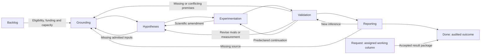

# Lykeion product and scientific workflow specification

Implementation companion: [fresh Go/daemon/Python API design](backend-api.md) and [feature-by-feature delivery plan](../plans/backend-implementation.md). These derive from this specification; they do not claim backend implementation or change scientific authority.

Version: 0.2. Date: 12 October 2026. Status: consolidated product specification; implementation contracts and acceptance requirements, not a claim that the system exists.

Lykeion conducts domain-general computational research through five persistent stages: **Grounding → Hypotheses → Experimentation → Validation → Reporting**. Each stage consumes versioned inputs, produces inspectable artifacts, and advances through an independently enforced gate. A completed inquiry has an audited immutable release, including when the scientific outcome is inconclusive, contested, or negative.

The product has TypeScript web and desktop clients and a Go CLI. A fresh Go control backend and independently supervised Go daemon own durable intent, execution, authorization, scheduling and state enforcement. Python provides the scientific API server and scientific execution/integration services. The exact public API topology is not yet selected: Python may expose scientific endpoints without becoming a second authority for durable state. Mobile is out of scope. Closing a desktop window must not terminate an authorized experiment.

## Reading guide

- [Objects and ownership](#work-objects-and-programme-ownership), [roles and review](#leads-configurations-and-independent-review), [admission](#admission-planning-and-work-in-progress-limits), [budgets and execution](#budgets-placement-and-offline-execution).
- [Artifact authority](#artifact-submission-tools-and-configuration-evolution), [knowledge](#programme-knowledge-and-sharing), [Autopilot/Copilot/Inbox](#autopilot-copilot-and-inbox).
- [Record contracts](#shared-record-catalogue), the five stages beginning with [Grounding](#grounding), and [jev policy](#routing-and-stopping).
- [Feature acceptance map](#feature-acceptance-map), [live desktop validation](#implementation-must-remain-grounded-in-the-running-desktop-reference), and [remaining implementation decisions](#implementation-sequence-and-decisions-still-to-specify).

## Authority and design status

This document is the single authoritative consolidation of the agreed product rules, scientific workflow, feature acceptance map and implementation validation process. It supersedes the earlier v0.1 routing, board, approval and lifecycle rules. Shared record shapes are logical contracts, not a commitment to endpoint names, database tables, libraries or wire formats. Numerical policy settings must be configured and versioned before use; an implementer must not invent them silently.

The [Multica reference inventory](../../research/multica-reference/INVENTORY.md), [Graphify receipt](../../research/multica-reference/GRAPHIFY.md), [desktop coverage inventory](../../research/visual-baseline/dashboard-coverage.md) and [asset provenance](asset-provenance.md) are supporting evidence. Multica contributes capability and failure-mode references, not mandatory module boundaries. Existing frontend API/architecture notes describe the rewrite's current provisional adapters; where they conflict, this specification controls the new contracts.

The installed `/Applications/Lykeion.app` is the primary interaction and visual reference. The obsolete reference website is not. The implementation must be independently authored, using approved brand assets. The user specifically requested investigating direct reuse of existing Lykeion Copilot UI/code: inspect authorship and dependency provenance before reuse; this is not blanket authorization to copy inherited Multica implementation. This process makes no legal clean-room claim.

This is a specification, not a statement that backend capabilities, scientific guarantees or full pixel parity are already implemented.

## Scientific invariants

1. Grounding is the only admission point for external scientific premises, data and methods into an inquiry. Protocol-declared live instrument readings are observations, not background imports. Logged Copilot retrieval remains session material until Grounding accepts it. Later stages cannot silently import new factual premises.
2. Every handoff names an immutable input snapshot. A mutable directory path or a model transcript is insufficient provenance.
3. Hypotheses outputs rival explanations and one chosen discriminating measurement. Alternative predictions refer to the same measurement.
4. Experimentation produces evidence and mechanical protocol decisions. It never commits the portfolio or scientific claim statuses.
5. Validation alone commits the accepted portfolio and claim ledger. Other stages submit proposals or requests.
6. Reporting adds no evidence or new inference. It renders one ledger version and its pinned dossier, then audits that rendering.
7. Process completion, artifact acceptance, stage advancement, and scientific support are separate decisions.
8. All attempts, exclusions, amendments, objections, and route-backs remain recorded. Negative results never justify selective retry.
9. An author cannot appoint its own reviewer, unilaterally change gate criteria, edit review records, or commit its own acceptance. Independence is enforced by capabilities and service identity; different role names alone do not establish it.
10. A gate can be passed autonomously. A missing verdict, timeout, budget exhaustion, or unavailable checker never counts as approval.
11. Done means an audited release exists. Publication is a separate human-authorized operation.
12. Reports and accepted scientific artifacts are never edited in place. Corrections create linked versions.

## Board and state model

The seven board columns are **Backlog → Grounding → Hypotheses → Experimentation → Validation → Reporting → Done**. The middle five are scientific stages. There is no separate Blocked column.

Keep card position, operational states, attempt lifecycle and scientific outcome distinct. A card can have several operational states; display priority is `quarantined > escalated > blocked > stale > paused > ready_waiting_for_capacity`. Show the other states and reasons on hover and through keyboard-accessible details. A gate-passed card waiting for destination capacity stays visibly in its current column with that reason. Review validity persists while pinned inputs and policy remain unchanged; resource/capacity eligibility is checked again at commitment.

Column headers show counts such as “Validation 3 · 1 blocked · 1 waiting”. The default human view is **Needs me**, spanning escalations, approvals and expiring deadlines across columns. Cards expose cycle counts, ownership and dependencies. Request cards identify blocked hypotheses and every consuming inquiry.

Done outcomes are `supported | refuted | inconclusive | contested | mixed | stopped`. The primary outcome is tied to the declared research question, with claim-status counts and an explanation. Mixed outcomes are allowed; consequential unresolved objections prevent a supported headline. `inadmissible` remains an evidence/claim status, not a substitute for the inquiry's explained terminal disposition.

Named commands are canonical; drag invokes the same command and leaves the same record:

- Forward drag targets only the next allowed column and submits a gate/transition request. Keep the card pending in place until the authoritative decision and capacity check; never move optimistically.
- Backward drag opens a routing-reason picker and creates a versioned routing record. It does not bypass amendment or access rules.
- Drag to Backlog displays the parking consequences, including released allocation and retained restart state, before confirmation.
- Drag to Done requires an audited release or closure package; otherwise refuse with the reason.
- Ordering inside a column records a human priority signal. The programme lead must record its response when selecting funding order; reordering never directly moves money.

Transitions are typed. Inquiry cards follow the scientific workflow, with explicit route-backs. Request cards live in their assigned working column and may move directly to Done after their acceptance gate and audited result package. Every consumer, including the owner, then imports the result through Grounding. Backlog eligibility alone does not move an inquiry to Grounding: funded selection and available capacity are also required.



## Work objects and programme ownership

- **Research programme (project):** persistent objective, standing domain/compute/data constraints, pooled budget allocated to inquiries, append-only knowledge catalogue and board. A one-off question may use a minimal programme without extra ceremony.
- **Inquiry card (task):** one enduring question with gates, a lead role, budget and versioned scientific history.
- **Request card (subtask):** a separately delegated deliverable another card can wait on; one owner, acceptance contract and allocation, potentially many consumers. Requests normally resolve missing data or methods through Grounding.
- **Spawned inquiry:** a different question, contradiction or runner-up becomes its own Backlog proposal linked `spawned_from`, not a subtask. A restart of permanently stopped work becomes a new inquiry linked `continues`.
- **Internal records:** experiments, trials, attempts, reviews, objections and outputs remain inside their owning inquiry. They do not become cards merely because they consume resources or receive technical checks.
- **Assignment:** authority belongs to a role, not a model/session. Each record records its producing role and concrete attempt.
- **Team:** programme roster of leads, specialists, reviewers and humans with explicit permissions. A roster does not automatically schedule parallel execution.

Requests use exclusive ownership and shared consumption. The owner defines acceptance and pays. A consumer cannot silently widen scope: the owner must amend acceptance with adjusted funding, or the consumer opens a dependent request. Accepted results enter the programme knowledge base as versioned artifacts; they do not bypass Grounding for the owner. The programme lead checks existing requests before creation and attaches matching consumers instead of duplicating work. If ownership ends while consumers remain, transfer ownership and funding to the programme lead or another consumer before stopping the owner; a human decision is required for this shared-dependency stop.

## Leads, configurations and independent review

The inquiry lead is a role plus durable `lead.md` state: current plan, open decisions, reason for the last route and exact accepted artifact/decision references. A fresh instance must be able to continue from files and authoritative events. Long conversational memory is not the source of truth. The lead delegates, proposes revisions and advance requests, but cannot write authoritative gate files. Specialists cannot move cards.

The programme lead selects funded work, allocates resources and manages parked inquiries. It is separate from inquiry leads so an inquiry cannot fund its own continuation. The human owns objectives and programme ceilings and authorizes reserved actions.

Separate **role**, **agent configuration**, **runtime** and **attempt**. A configuration pins model/provider identifiers where exposed, instructions, skills, tool capabilities and permissions. Each attempt freezes its configuration hash for its whole lifetime, including resumed execution. Record provider version uncertainty rather than claiming a mutable alias pins model weights.

Each role has an approved configuration list. The programme lead selects working configurations using cost and track record. Reviewer configurations are assigned by a system rotation/draw outside the author and lead's control; record the selection and eligibility policy. No reviewer shopping: a completed verdict can be challenged only through adjudication or an appropriately revised submission.

All reviews, including human reviews, require: fresh context; read-only access to the submitted snapshots and required verification records; no authorship of those artifacts; selection outside the author's control; blindness to author reasoning and other reviewers' verdicts; and a non-rerollable verdict. Domain mechanisms and methods in the submission remain reviewable; private author deliberation is not supplied. Adjudication follows independent reviews and can read their recorded disagreements.

Independence is procedural. Diversity reduces correlated errors without proving independence. For model-based reviewing/replication, require a different model family from the relevant authoring attempt for consequential Validation decisions and R3 replication. Human reviewers still satisfy all procedural independence requirements. Routine dossier/protocol gates require independence; stricter diversity can be configured by programme policy. Missing eligible reviewers blocks or escalates, never silently relaxes the policy.

Only absent verdicts caused by eligible crashes/timeouts permit replacement. `cannot_assess` is a verdict and goes to adjudication. Seal partial review outputs from replacements; retain them for auditors/adjudicators afterwards. Record both draws. After policy-defined K failed review attempts on the same artifact, stop replacement and escalate possible malformed, excessive or adversarial inputs.

## Admission, planning and work-in-progress limits

Admission is rule-based eligibility evaluated by jev. Selection is the programme lead's recorded funding judgment among eligible inquiries. Readiness requires an objective link, bounded initial question, eligible lead configuration and feasible allocation for Grounding plus review. Fund feasibility discovery rather than demanding it in advance.

Deduplication checks accepted knowledge and the inquiry registry, including in-progress, parked and stopped work. A repeated question must state what changed: data, method, claim reversal or another justified difference. Human proposals are not rate-limited; agent proposals have programme-defined rate caps. Eligibility is rechecked at funding commitment, and authorization cannot reduce reserves owed to existing work below their requirements.

Selection records expected uncertainty reduction, objective relevance, cost and dependency-unlocking value. Compare estimates with realized costs and outcomes for planning calibration; these are not truth scores. A small human-set exploration allocation selects eligible inquiries by a distinct policy, such as portfolio distance or random draw, not the ordinary payoff ranking. Exploratory selection does not lower any scientific gate standard.

Use a rolling plan: detailed funded current-stage work, provisional later stages, reassessment after gates. Apply per-column WIP limits, tightest at Validation, and a cap on open escalations. Limits protect review capacity, human attention and completion funding as well as compute. Upstream work waits visibly when destination capacity is full. Requests and inquiry work consuming a column's review capacity must be accounted for by the explicit WIP policy; they cannot be hidden to evade limits.

## Budgets, placement and offline execution

Track model spend, compute and elapsed-time/deadline limits separately; they are not interchangeable. Monetary/resource accounting distinguishes allocated-but-uncommitted, committed and spent amounts without double counting. An attempt reserves its permitted cost before authorization and settles actual usage with durable receipts.

Each inquiry has working allocation and protected review/report reserve. Size the reserve from its decisive plan, including R2 and triggered R3 obligations. Do not authorize work whose verification obligations cannot be covered. Request funding is an explicit transfer from its owner, not newly created allocation. Remaining funds return to the programme at release.

The programme lead may redistribute only uncommitted working allocation within the human-approved ceiling. Never touch protected reserves; preserve each inquiry's floor sufficient to finish its current gated step. Transfers cannot purchase extra frozen decisive trials unless a predeclared sequential rule permits them. Log reasons; transfers above a human-set programme share notify the human. Budget increases require human approval.

The scheduler chooses an eligible runtime from declared CPU/GPU, memory, environment, data-class and reproducibility requirements. Record runtime class on each attempt; R2 uses a comparable class or records an explicit comparability failure. Enrolled local compute is eligible by default within policy. Remote/paid compute requires programme opt-in naming allowed providers and egress data classes. Budget authority never overrides egress restrictions.

Offline decisive execution is allowed only for data classes whose policy permits it, under a renewable authorization lease. Freeze contract, input hashes, implementation/environment digest, permissions, configuration and local spending cap. Renew by heartbeat online. Offline execution stops at expiry, with a fixed shutdown grace solely to save state and shut down: no new computation steps, seeds or runs. Licensed/private data with revocable access terms requires connectivity; the authorization policy bounds loss-of-contact detection rather than promising physically instantaneous revocation.

Retain outputs with attempt identity and hashes in a durable local outbox, quarantined until reconciliation. Reconnection checks authorization over the full scientific execution interval, input revocation and supersession, spending and artifact integrity. Revoked inputs invalidate; superseded inputs make outputs stale for the new version. Saving state during shutdown grace does not extend authorized computation. Resuming the same frozen run/checkpoint under a new lease is a recorded infrastructure retry; the original contract declares how interruptions count and prevents quiet exclusions.

A lost callback is not proof of no result. Reconcile existing terminal outputs before replacing work. A stale worker cannot overwrite newer state: leases include fencing and completion acceptance is idempotent.

## Revisions, stopping and escalations

**Supersede:** a better version exists but the old one was legitimate. Mark affected artifact-level descendants stale, preserve validity about their pinned old inputs and historical decisions. Running attempts may finish as retained exploratory records ineligible under the new version, unless remaining cost exceeds a configured cancellation threshold. The lead proposes rebasing; only affected checks rerun.

**Revoke:** an input is wrong, contaminated, forbidden or withdrawn. Stop affected work, quarantine artifacts and invalidate dependent acceptance. Issue linked erratum/retraction versions for dependent releases. Revocation cannot reach an offline machine before contact; the lease and data-class connectivity policy bound that risk. Dependency propagation follows actual edges, not blanket inquiry invalidation except integrity freezes.

| Operation | Rule |
| --- | --- |
| Pause | Stop new dispatch; retain uncommitted reservations only for the configured window. On expiry automatically park; active-attempt disposition follows its execution contract. |
| Park | Move to Backlog, release uncommitted allocation while preserving restart state and existing obligations/accounting. |
| Done · inconclusive | Validation has no affordable decisive next test; route through full Reporting and audit. This is a scientific result. |
| Permanent stop | End before reportable scientific evidence, e.g. no feasible route or changed objective; create a shorter audited closure package. This is a non-result, not an inconclusive finding. Preserve any partial evidence. |

The programme lead, never the inquiry's own lead, may stop under human-approved rules such as N unsuccessful feasibility requests or expired pause. Notify the human every time. Reasons outside policy, or stops affecting shared requests, require a human; transfer request ownership first. A permanent stop is not resumed in place: create a linked `continues` inquiry. Budget exhaustion after Validation routes to Reporting, not a stop shortcut.

Ordinary escalations block only the affected decision and dependents. Unrelated work can continue; adjacent work whose usefulness depends on the decision has a capped allocation. Integrity escalations—suspected fabrication, reserved-data access or permission breach—freeze the whole inquiry, quarantine its artifacts and suspend the implicated configuration programme-wide pending resolution. Integrity freezes never clear merely because a deadline expires.

Every escalation states its deadline and pre-approved deadline action before the human responds. Silence is never approval.

## Artifact submission, tools and configuration evolution

Working folders are ordinary editable directories, including worktrees. Submission seals a manifest and writes content-addressed artifacts. Humans, CLI edits and agents use the same boundary; there is no hotfix of a reviewed version. Reviewers/runners mount the sealed snapshot read-only. Hooks reject writes, backed by storage permissions and sandbox enforcement rather than relying on hooks alone.

Authored artifacts follow draft → submitted version. Produced logs, outputs and verdicts have no editable submission stage: capture them through the trusted execution layer and seal the attempt directory at termination/interruption, including failures and partial results. Streamed receipts are append-only. Large data may be hash-referenced without redundant copying only with verified identity, authorized access and retention sufficient for the declared reproducibility obligations. A hash alone is not an availability guarantee.

External inquiry premises enter through logged Grounding connectors. Install dependencies only from allowlisted registries with hash-pinned lockfiles; no arbitrary download URLs or installer access to unlogged scientific sources. Generated code inherits the invoking role's restrictions.

A frozen protocol may declare a **live instrument**: endpoint, parameters, schedule, exposed service/model version, repeats and expected stochastic behavior. Grounding verifies access/feasibility first. A recording proxy is its only network path; it blocks undeclared requests and logs requests/responses, timestamps and hashes as raw outputs. Secret-bearing traces remain access-controlled and public exports redact credentials without claiming to be the original raw bytes. R1 replays recorded responses. Live R2 is labelled re-execution across time: differences may reflect instrument drift and require adjudication rather than automatic scientific refutation.

| Configuration change | Approval |
| --- | --- |
| Expands tools, connector/data access or network paths | Human, always |
| Changes reviewers, validators, jev policies or audit behavior | Human, always, even with identical permissions |
| Improves a working role without either effect above | Automatic only after role regression evaluations and independent review; notify the human and support rollback |

Lessons are candidate instruction changes, never silently injected into prompts. Approved changes enter the role's eligible list only for new attempts. Existing attempts retain their original configuration, including after infrastructure resume. Rollback changes future selection; it never rewrites historical configurations or verdicts.

## Programme knowledge and sharing

Accepted dossiers/request packages, released claim ledgers and approved lessons enter an append-only versioned catalogue. Released histories carry retired hypotheses, negative results and failure lessons. Every item carries origin, status, scope (data, conditions, population), restrictions and evidence lineage. Imports always pass through the consuming inquiry's Grounding, pin the exact knowledge version and retain status. A contested claim never becomes background fact by retrieval. A newer version produces an availability notice, not silent drift.

Provide a separate diagnostic search over drafts, in-review, rejected and stale internal records for debugging, deduplication and failure analysis. Label every result unaccepted with current state; it is not importable. Relevant work must pass its own gates before a newly accepted version can be imported. Apply record access and outcome blinding: roles still blinded cannot discover related sealed decisive outputs through search. Authorized auditors, adjudicators and humans may inspect them, with access logged.

Grounding retrieval returns supporting and challenging groups plus an unranked mandatory group on the same question/hypothesis lineage, including retired/refuted work. Within access and blinding constraints, pagination/ranking must not silently omit this mandatory group. Count distinct evidence roots and show shared inputs (e.g. “2 experiments, 1 dataset”). This exposes provenance diversity; root count alone does not prove statistical independence.

Programme-private is the default. A human-approved policy may publish releases and accepted request packages automatically to a workspace library only when audited/accepted, unrestricted and free of open escalations, integrity incidents or revoked dependencies. Derived artifacts inherit source restrictions, including summaries, fitted models and statistics, until a recorded human declassification. Restricted-derived publication requires per-item human approval and permitted declassification; approval alone must not silently strip inherited class. Placement and export/publication both read that inherited classification.

Retract publication through a linked retraction version, not catalogue deletion. Retraction propagates as revocation to pinned consumers and invalidates dependents. Retain audit history subject to access controls; immutable catalogue history is not permission to retain or expose forbidden payload bytes. Exceptional payload removal, if required by a data-retention policy, must leave an auditable unavailable/revoked reference rather than silently replace bytes.

## Autopilot, Copilot and Inbox

### Autopilot

Human-approved schedules/events/templates create Backlog proposals, never directly execute scientific work. Record triggering event, template version, scope and proposed budget. Templates define rate, deduplication window and pending-proposal limits. Duplicate events link to existing proposals; record additional reasons. The programme lead funds eligible proposals after jev admission. Pausing a template stops new proposals, not existing inquiries. Admission, parking and rejection have recorded reasons; intake rejection is not a scientific refutation.

### Copilot quick tasks

Copilot is the selected agent's quick-task execution workspace, following the current Lykeion interaction pattern: agent identity, starter prompts, attachments and Experiment/Cowrite modes. Starter prompts fill without submitting. Quick tasks have a separate human-approved allowance and durable sessions, attempts and artifacts; they do not automatically become board inquiries or consume inquiry reserves. Mode switches preserve history and do not widen configuration permissions.

**Experiment:** autonomously inspect data, write/run code, perform exploratory analyses and generate plots inside an isolated workspace, within the session cap and approved permissions. Log retrieval through connectors, and record all inputs, code, environments, failures, outputs and costs. Results are exploratory, never automatically preregistered, validated or gate-accepted. Promotion cannot make already-seen data an untouched confirmatory set.

**Cowrite:** edit the shared working document directly with attribution, revision history and undo; offer optional suggestions. Preserve evidence links and claim status during edits, flag unsupported statements and avoid silently upgrading them to findings. The mode itself grants no code-execution authority. Editing a released document creates a draft revision. A needed computation is a bounded Experiment subtask inside the session, with explicit user confirmation and linked outputs/provenance.

Quick tasks may retrieve external scientific material as logged session sources. On promotion, Grounding must review/import it before it becomes inquiry evidence. Copilot cannot write accepted dossiers, claim ledgers or gates. It recommends promotion; the user confirms a Backlog proposal linked to the intact session. Reaching scope/budget limits pauses work for an explicit scope change or promotion, not automatic continuation.

### Inbox and human authority

Separate actionable decisions from informational notifications. Pin subject/artifact/policy versions, permitted structured responses, authorized responders, rationale requirements, deadline and deadline action. Comments are discussion only. Record responder, selected action, exact scope/version and rationale. Input changes supersede the item; old approvals cannot authorize the new version. Duplicate response delivery has one effect and conflicting responses cannot both commit.

There is no force advance, including for humans. A qualified independently assigned human may review under the same independence rules; changing a gate uses a versioned policy amendment and reevaluation; a person needing unvalidated material may export it with that label and its access restrictions, without moving the card or adding it to accepted knowledge. Changing objectives or stopping uses the normal recorded commands. External publication/submission and reserved access/budget actions require approvals bound to the exact action.

## Persistent storage and file conventions

The card is represented by an inspectable folder. Accepted content is stored as immutable artifacts; the Go service maintains authoritative acceptance, access, event ordering, and current-version pointers. Files exported to a workspace are projections of those accepted artifacts. Editing an exported file creates a candidate revision, not an accepted state change. A local deployment uses the same control semantics.

JSON and JSONL use UTF-8. JSONL has one complete object per line; published logs are append-only. YAML accepts only JSON-compatible scalar, sequence, and mapping values, rejects duplicate keys, and disables executable/custom tags. Markdown artifacts with structured fields use YAML frontmatter. Structured schemas reject unknown core keys; profile additions live under `extensions`.

All records have the common envelope `schema_version`, `id`, `scope_ref` (programme, inquiry, request or quick session), `revision`, `created_at`, `producer`, `input_refs`, and `extensions`; inquiry-owned records additionally identify `inquiry_id`. `producer` records the authenticated role, actor, run, and available model/tool versions. Timestamps are UTC RFC 3339. Revision numbers increase within an entity; references always pin a revision. IDs are opaque and unique, with readable prefixes such as `H-`, `E-`, `V-`, `C-`, and `O-` for presentation.

### Shared types

| Type | Required fields and rules |
| --- | --- |
| ArtifactRef | `artifact_id`, `revision`, `sha256`, `media_type`, `byte_length`; optional workspace `path`. Paths are relative, cannot escape the inquiry, and cannot redirect through symlinks. Large data may live in authorized object storage with pinned identity. |
| RecordRef | `artifact_ref`, `record_id`; for structured collections, resolves an exact record in the pinned artifact. |
| Manifest | `kind`, ordered `entries: ArtifactRef[]`, `input_refs`, `policy_ref`; entries have unique paths. SHA-256 covers exact accepted file bytes. A manifest never hashes itself. |
| Gate | `subject_ref`, `stage_or_admission`, `candidate_manifest_ref`, `policy_ref`, `review_refs`, `classification_refs`, `checks`, `decision`, `rule_ids`, `missing_items`, `route_target`, `reasons`, `evaluator_version`. Decision is exactly `advance`, `block`, `route` or `escalate`. Checks have `criterion_id`, mechanical/classified kind, `pass/fail/pending/not_applicable` result and evidence refs. Not-applicable requires policy permission. Persist exact structured inputs for deterministic replay. |
| Event | `sequence`, `event_type`, `subject_ref`, `actor`, `recorded_at`, `idempotency_key`, `payload`, `previous_hash`, `event_hash`. The control service assigns ordering and anchors the chain outside author permissions. |
| Review | `subject_refs`, `reviewer_identity`, `policy_ref`, `verdict`, `criterion_results`, `objection_refs`, `rationale`. Authors cannot choose reviewer identity or mutate the submitted review. |
| Measurement | `measurement_id`, `quantity`, `units`, `population_or_system`, `conditions`, `method_ref`, `uncertainty_model`, `required_precision`. Domain profiles may represent categorical, symbolic, or distributional outcomes. |
| NumericValue | `value`, `units`, `source_ref`, `selector`, `derivation_ref`, `format_rule`. A raw number alone cannot establish provenance. A null value requires an explicit reason. |
| RequestCard | `owner_ref`, `consumer_refs` (including blocked hypothesis/version), `ask`, `acceptance_ref`, `working_stage`, `required_inputs`, `deduplication_key`, `allocation_ref`, `deadline`, `status`, `resolution_refs`, `ownership_history`. Completion pins an accepted result package. Timeout never satisfies a dependency. |
| Amendment | `supersedes_ref`, `reason`, `changed_fields`, `outcome_exposure`, `affected_refs`, `required_reviews`. An amendment never overwrites its predecessor. |

Event hashes cover a deterministic serialization of the event excluding `event_hash`. The schema implementation must choose and document that serialization once. A hash chain alone does not prove chronology against an actor who can rewrite the whole chain; the trusted service records the accepted root before dispatching decisive work.

### Workspace and inquiry directories

These are inspectable logical projections, not a mandate for one physical storage backend. Sealed artifacts live separately from writable drafts. Programme, request and quick-session state cannot be inferred from inquiry filenames alone.

```text
programmes/<id>/
  programme.json
  policies/<version>/
  roster.json
  lead.md
  planning.jsonl
  budget.jsonl
  knowledge/index.jsonl
  sharing.jsonl
requests/<id>/
  request.json
  working/
  result/<version>/manifest.json
  gate.json
  events.jsonl
quick-sessions/<id>/
  session.json
  documents/
  attempts/
  retrieval.jsonl
  events.jsonl
inquiries/<id>/
  inquiry.json
  lead.md
  profile.yaml
  events.jsonl
  grounding/v<n>/
    question.md
    sources.jsonl
    evidence.jsonl
    datasets.jsonl
    methods.md
    constraints.yaml
    gaps.md
    search_log.jsonl
    feasibility/
    manifest.json
    gate.json
  hypotheses/v<n>/
    H-<id>.md
    reviews/
    portfolio.proposed.yaml
    portfolio.yaml
    bank.jsonl
    next_test.md
    requests/
    manifest.json
    gate.json
  experiments/E-<id>/
    contract.yaml
    ledger.jsonl
    dev/
    src/
    env/
    runs/
    attempts.jsonl
    outcome.json
    bundle.json
    gate.json
  validation/V-<id>/
    integrity.json
    reproduction/
    replication/
    reviews/
    objections.jsonl
    claims.jsonl
    approved_artifacts.json
    portfolio_update.json
    route.json
    manifest.json
    gate.json
  report/v<n>/
    ledger_ref.json
    report.md
    sentences.jsonl
    figures/
    figures.manifest.json
    manuscript/
    repro/
    audit.json
    release.manifest.json
    RELEASE
```

`manifest.json`, `bundle.json`, `approved_artifacts.json`, `figures.manifest.json`, and `release.manifest.json` specialize the shared Manifest type. `gate.json` always uses Gate. `events.jsonl`, experiment `ledger.jsonl`, `attempts.jsonl`, and `bank.jsonl` use Event with the payload specified below. A version directory is provisional until accepted. `portfolio.yaml` is a Validation-authored projection even when placed beside Hypotheses artifacts.

## Shared record catalogue

This catalogue defines each logical record once. Stage sections specify who creates and consumes it.

| Artifact or record | Required payload beyond the common envelope |
| --- | --- |
| programme.json | Objective, owner, standing constraints/profile, policy refs, budget ceilings, WIP/escalation limits, lead role, board/knowledge refs, remote-provider/egress opt-in, proposal limits. |
| lead.md | Role/scope, current plan, open decisions, last route and reason, pinned artifact/decision refs, unfinished work, next proposed actions; narrative is never a jev gate argument. |
| roster / role / configuration | Role responsibility and capabilities, independent-review constraints, approved configuration refs, approval/evaluation history; configuration hash pins instructions, skills, tools and model identifiers. |
| planning decision | Eligible proposal refs, readiness receipts, estimated cost/uncertainty reduction, selection criteria/policy, exploration draw if used, chosen allocation, human priority signal/response, realized outcome/cost refs. |
| budget event | Programme/inquiry/request/session scope, unit/dimension, allocated/committed/spent movement, prior balance/version, reservation/attempt ref, protected reserve and floor, reason, actor, notification and settlement refs. |
| authorization lease | Attempt/trial/configuration refs, frozen manifests, runtime/class, permission/data policy, spending cap, issued/expires times, renewals, fencing token, shutdown grace, checkpoint/accounting rules. |
| knowledge item / import | Accepted artifact ref, origin/evidence roots/shared-input refs, scope/status, inherited class, publication/retraction refs; import pins catalogue/item versions and Grounding acceptance. |
| Inbox decision | Subject/input/policy refs, authorized responders, allowed structured choices, rationale requirements, deadline/action, responses, supersession/conflict/commit record; discussion refs separate. |
| Autopilot template / event | Approved template version, trigger, scope, proposed allocation, rate/pending/dedup limits, event receipt and resulting Backlog proposal refs. |
| quick session | Selected approved role/configuration, mode, separate allowance, versioned input/document refs, attempts/retrieval logs, cross-mode confirmation, promotion recommendation/confirmation and inquiry link. |
| configuration change | Prior/proposed hashes, access and gate-behavior impact classification, regression receipts, independent review, required human approval, notification, activation/rollback history. |
| integrity incident / revocation | Affected configuration/input/artifact refs, suspicion or confirmed reason, freeze/quarantine scope, dependency effects, reviewer/adjudication/resolution refs, notices, errata and access restrictions. |
| inquiry.json | Original input reference/type, programme, lead role, column, operational states/reasons, admission/selection refs, outcome with claim counts/explanation, stop reason, accepted stage refs, active work refs, profile/policy refs, budget ledger, cycle count, spawned/continues links. |
| profile.yaml | Domain identifier/version, schema extensions, allowed computation capabilities, statistical procedures and assumptions, admissibility criteria, R2 sampling/tolerances, R3 triggers, review lenses, wording policy, routing policy, resource ceilings. No profile can relax core authority or provenance invariants. |
| question.md | Scoped question, scope boundaries, narrowing trail with reasons, parked alternative inquiry refs, source input ref. Body explains the research objective. |
| sources.jsonl | Source identity, title, creators, DOI/URL where available, version, retrieval time, originating search receipt refs, content snapshot ref, access and reuse constraints, screening disposition/reasons, superseded/retracted status if checked. |
| evidence.jsonl | Claim or contextual statement, verbatim passage, source ref, page/section/offset locator, relation (`supports`, `challenges`, `context`), extraction method, verification result. User inputs can be captured as attributed source records; they do not become established scientific facts. |
| datasets.jsonl | Dataset identity/version, content refs/checksums, access constraints, opening receipt, schema, units, coverage, missingness summary, intended role, feasibility verdict/reasons. Reserved partitions are referenced through access-controlled manifests. |
| methods.md | Structured method records with IDs, dossier evidence refs, required inputs, applicable conditions, reported baseline values and their provenance, limitations. Body synthesizes existing approaches. Baselines are the best found within documented search scope, not a universal best. |
| constraints.yaml | Budget currency and cap, compute limits, deadline, per-stage allocations, Grounding-request reserve, mandatory validation/report reserve, retry limits, route-back limit, autonomy permissions. |
| gaps.md | Structured gap IDs, unresolved question, affected scope, search/access limitation, materiality, resolving evidence, disposition. Body explains remaining uncertainty. |
| search_log.jsonl | Events for requested/completed/failed retrievals: connector/version, query, parameters, timestamp, response artifact refs, error, cost. Written by the connector execution layer, including unsuccessful calls. |
| feasibility receipt | Input refs, command/tool, environment ref, sampled/opened data or simulation input, outputs, observed resource use, relevance assessment, limitations. A stub establishes only the capability it actually exercises. |
| H-<id>.md | Statement, mechanism or explicitly unknown mechanism, entities, dossier ref, evidence refs, assumptions with plausibility/rationale, rival refs, predictions on shared measurements, falsification criteria, novelty relative to baseline, lineage refs, generation strategy, feasibility status, profile extensions. Body elaborates the mechanism and assumptions. |
| portfolio | Dossier ref, hypothesis refs, per-member disposition (`active`, `parked`, `blocked`, `retired`) and reason, diversity groups, selection rationale, leader if meaningful, chosen test ref, acceptance ref. Proposal and accepted portfolio share this format; only the latter has authority. |
| hypothesis bank event | Hypothesis/version ref, event kind, reviewer preference score if present, empirical assessment refs, test count with trial refs, previous standing, resulting standing, Validation decision ref. Elo and empirical measures are separate fields. No universal empirical score is assumed across domains. |
| next_test.md | Portfolio proposal ref, selected measurement, rival prediction matrix, candidate tests considered, expected discrimination accounting for uncertainty, cost estimates, selection rule/rationale, feasibility refs, provisional stopping/analysis requirements. Body explains why this is the best reviewed candidate. |
| contract.yaml | Accepted portfolio/test refs, dossier/profile refs, measurement and rival predictions, thresholds, support/refutation/inconclusive rules, data roles, metric/evaluator refs, seeds or sampling plan, controls, analysis plan, exclusions, stopping rule, development/decisive separation, reserved-evaluation strategy, retry policy, tolerances, R2 sample plan, budget reservation, implementation manifest ref, freeze event ref. |
| attempt event | Trial ID, attempt ID, phase (`development`, `decisive`, `reproduction`, `replication`), contract/implementation/input refs, planned seed/config, runtime identity, started/finished times, logs/raw output refs, resource use, exit classification, metric presence, accounting disposition/reason, retry parent. Recorded by the runtime. |
| outcome.json | Contract ref, included/excluded/rejected attempt refs, computed NumericValues, per-prediction protocol decision (`criterion_met`, `criterion_not_met`, `inconclusive`, `not_evaluable`), admissibility (`passed`, `failed`, `deviated`), rule identifiers, deviations, frozen analysis execution receipt. No scientific endorsement field. |
| reproduction record | Tier (`R0`, `R1`, `R2`, `R3`), subject refs, planned sample, environment, receipts, expected and observed values, comparison rule/tolerance, result (`passed`, `failed`, `pending`), failure classification, coverage/limitations, objection refs. |
| objection | Claim/candidate claim refs, lens, severity, precise concern, evidence refs, proposed resolving evidence, responses, status (`open`, `resolved`, `withdrawn`), adjudication ref and rationale. Never averaged away. |
| claims.jsonl | Claim text, kind (`scientific`, `method`, `provenance`, `administrative`), hypothesis refs where applicable, scope/conditions, status (`supported`, `contested`, `refuted`, `inconclusive`, `inadmissible`), admissible evidence refs, outcome/reproduction refs, criterion refs, NumericValues, uncertainty/limitations, objections, permitted wording, prior claim ref, Validation decision ref. |
| portfolio_update.json | Expected prior portfolio ref, proposed next portfolio ref, claim/objection refs, decision reasons, reviewer acceptance refs. Applied atomically by Validation through the control service. |
| route.json | Pinned structured decision inputs/hash, jev evaluator version, classification artifact refs where used, policy ref, rule IDs, decision and named destination, affected branch/card, required artifacts, budget/reserve refs, cycle count, reason, notification refs, enforcement result. No narrative prompt or sampled model choice decides the route. |
| ledger_ref.json | Accepted claim ledger ref, accepted dossier ref, portfolio/history refs, approved artifact refs, reporting policy and renderer refs, prior release ref, revision reason/erratum if applicable. |
| sentence record | Stable sentence ID, exact text/hash, section and output location, kind (`finding`, `background`, `connective`), claim refs or dossier evidence refs, NumericValue refs, required qualifiers/status wording, audit findings. A new inference is rejected, not an accepted fourth kind. |
| figure manifest entry | Figure/table ID, approved data refs/selectors, approved script ref, environment/fonts/render parameters, linked claim refs, caption sentence refs, canonical output ref and hash. No new statistical analysis or selective filtering. |
| audit.json | Pinned report input refs, claim coverage, sentence classification/faithfulness review, numeric/citation checks, figure regeneration receipts, R1 receipt, manuscript subset check, auditor identity, unresolved findings, overall pass/fail/pending. |
| RELEASE | JSON record containing release manifest ref/hash, audit ref, trusted release event ref, version, publication state. Excluded from its own manifest to avoid a hash cycle. |

Review files use the shared Review format with profile-defined criterion sets. Run directories and `repro/` contain artifacts plus manifests and execution receipts, not additional competing schema definitions. Skill instructions describe these contracts; they cannot grant capabilities or modify policies.

## Grounding

Grounding admits outside knowledge into the inquiry and creates a dossier sufficient for the scoped question. Its independent reviewer checks completeness against declared criteria and traceability, not exhaustive knowledge of the field.

Entry accepts a question, topic, or file. The scoper records narrowing decisions and creates parked cards for worthwhile alternatives. After an initial scope exists, literature, contrary-evidence, data, and methods scouts work concurrently within allocated budgets. Each writes isolated candidate artifacts; a controlled merge produces the dossier. The contrarian never races the literature scout on a shared JSONL file.

Grounding covers literature, data, methods, and resources. It records passage-level evidence, contrary searches, inaccessible sources, dataset inspection, and at least one verified computational route. A dataset must be opened and inspected for relevant structure; a simulation stub must exercise a relevant capability. Neither proves a later scientific result.

Connectors may include scientific indexes, repositories, a user's library, and dataset hubs. PaperQA is a possible passage retrieval component. Every retrieval passes through a system logger. A crash between request and response leaves a visible incomplete receipt. Installation and transport adapters must not become unlogged channels for scientific retrieval.

Mechanical checks resolve references, verify captured passages and receipts, validate formats, and check route artifacts. A separately assigned reviewer evaluates scientific sufficiency. An LLM may classify passage relevance into policy-defined fields, but its classification is a separately sealed artifact, not a mechanical proof or the gate decision. jev evaluates rules against the pinned check/verdict inputs.

Exit requires a scoped question, traceable and relevant evidence, a recorded contrary search, explicit gaps, a verified computational route, and an accepted manifest. Failure returns to the deficient step. New evidence requested downstream creates a new dossier version and re-review; previous versions remain intact. Dependent descendants are marked for reassessment according to their input links.

## Hypotheses

Hypotheses outputs a decision: a bounded set of rivals and the measurement expected to distinguish them most usefully within budget.

Generators use literature synthesis, alternatives, admitted data, and evolution strategies. They receive a pinned dossier and no external retrieval capability. They may propose new conjectures, but every cited factual premise resolves to dossier evidence. A mechanism may be unknown with a limitation; a schema must not induce invented causality.

Every rival predicts an outcome on the same measurement. A falsifier specifies the measurement, direction or outcome region, and threshold or domain-appropriate decision rule. Assumptions have plausibility ratings. Novelty refers to the dossier baseline. Rewrites create descendant versions and cannot inherit empirical support automatically.

A separate reviewer checks correctness, testability, feasibility, assumptions, and novelty. Reviewer judgments such as `already_explained`, `other_more_likely`, `missing_piece`, `neutral`, and `disproved` are review opinions; they do not directly set a claim ledger status.

The ranker selects a diverse bounded portfolio, including an exploratory candidate when a qualifying one exists. Reviewer preference ranking and experimental information value remain distinct. Test selection considers differing predictions, measurement uncertainty, feasibility, and cost; counting separated rivals per cost is only a heuristic. No global optimality claim is made.

Blocked candidates first receive a feasibility rewrite attempt. Grounding requests are limited to active candidates or candidates with justified discriminating value, merged by need, and funded from a reserve. Expiry parks the candidate. No blocked hypothesis participates in a decisive test.

The gate requires at least two meaningful active rivals, which may include a null/baseline, a feasible discriminating test, valid dossier links, and independent review. If no genuine rival or test exists, record the impasse rather than fabricate one. Hypotheses writes a portfolio proposal. A Validation-owned acceptance operation commits the portfolio at this gate without moving the inquiry into the later Validation stage.

## Experimentation

Experimentation turns the selected measurement into a frozen computational protocol, runs it, and packages evidence. It has no authority to change scientific standing.

Development uses designated exploratory data or simulations. Builders may change implementation and run pilots within limits. These results never acquire confirmatory status retrospectively. Before decisive execution, freeze both scientific contract and exact code, dependencies, environment, evaluator, and configuration.

Admissibility checks cover profile-appropriate power or precision, controls, metric definition, input roles, resource feasibility, and contract consistency. An independent protocol reviewer checks compliance with the chosen test and then rigor, including leakage and confounds. Requirements such as power are profile-specific, not universal constants.

Reserved evaluation may be held-out data, fresh seeds, new simulation conditions, or none with an accepted justification. These strategies answer different validity questions; fresh seeds do not establish generalization to new populations. Reserved resources are inaccessible to builders and their generated code except through a trusted evaluation interface. Output release is controlled so logs cannot leak decisive inputs back into search. Network is denied for decisive workloads except an explicitly frozen live-instrument route through the recording proxy. Pinned dependency installation is separately constrained to allowlisted registries; newly needed scientific premises/documentation/data return through Grounding.

A trusted runner with no code-editing capability executes decisive trials on the selected runtime. It logs attempts before execution and records all terminal outcomes through a durable outbox. Each attempt is counted, excluded under a declared rule, or rejected with a reason. NaN, divergence, out-of-memory, or timeout may be scientifically informative; absence of a number alone does not authorize retry. A metric or completed verdict, including unfavorable/invalid output, prohibits rerolling the attempt. Missing a result is necessary but not sufficient: classify the failure against the predeclared infrastructure policy. Eligible retries preserve the trial's seed/configuration and remain bounded. Planned multi-seed trials are not retries.

Scientific changes return to Hypotheses as amendments. A bug discovered after decisive exposure creates a linked revision and deviation; the old result remains visible. An anomaly investigator can inspect permitted artifacts, but cannot discard runs, alter thresholds, or retroactively change exclusions. New analyses are exploratory until separately accepted.

The frozen analysis emits protocol decisions and admissibility separately. It does not label a hypothesis confirmed. A technically valid negative or inconclusive run can complete Experimentation. The exit gate checks complete bundle, trusted freeze, contract compliance/deviations, and accounting for every attempt. A documented failed campaign can be routed to Validation for an inadmissibility/stopping assessment without pretending its experiment gate passed.

## Validation

Validation independently determines admissibility and scientific meaning. It owns all accepted portfolio updates and publishes a versioned claim ledger, including claims about methods, provenance, and expenditure needed for faithful reporting.

| Tier | Check | Requirement |
| --- | --- | --- |
| R0 Integrity | Trusted manifest/ledger verification, completeness, all attempts accounted for | Always |
| R1 Analysis | Independently run the frozen analysis from raw outputs and compare to the recorded outcome | Always for available experiment evidence |
| R2 Re-execution | Execute the preselected sample of decisive runs in a clean environment and compare within declared tolerances | Every decisive experiment |
| R3 Replication | Independently implement the contract using approved input data and interface constraints, isolated from original implementation and outcome values until frozen | Triggered |

R2 cost is reserved before experiment admission. Its sample and tolerances are fixed before inspecting convenient results. Coverage is explicit; a sample does not verify unselected trials. Failed required R0–R2 checks make the affected evidence inadmissible. For declared stochastic live instruments, apply the prespecified across-time comparison and investigate instrument drift before classifying a discrepancy as reproduction failure. An unavailable resource or incomplete attempt leaves the check pending and blocks endorsement, rather than proving a scientific failure.

R3 triggers include a profile requirement, a proposed change of portfolio leader, a surprisingly large effect under a predefined criterion, an investigated anomaly, or a deviated outcome. R3 failure opens an objection rather than automatically refuting the hypothesis. Triggered R3 remains a required unresolved obligation; lack of budget cannot quietly waive it. The claim remains unendorsed, with the reason reported.

Review lenses include reproducibility, statistics, domain validity, and workflow pitfalls: benchmark selection, leakage, metric misuse, and post-hoc selection. Reviewers can inspect code, logs, data roles, and the full trial history. They receive no external search capability. Model agreement is not a correctness metric or reviewer reward.

Objections are separate records with severity, evidence, and resolution conditions. The adjudicator can weigh admitted evidence and responses but cannot add outside evidence. A resolvable objection may trigger a test within budget. Otherwise it persists. Consequential unresolved objections produce a human notification; silence does not endorse the claim.

| Claim status | Meaning | Reporting treatment |
| --- | --- | --- |
| supported | Admissible evidence meets the declared support criterion; no unresolved scientific objection; scope and uncertainty retained | May assert only the qualified accepted claim |
| contested | A scientific objection remains unresolved | Detailed claim appears only in Disagreements with objection and resolving evidence |
| refuted | Admissible evidence meets the declared criterion against the specified claim under the stated conditions | Report the refutation, not the original claim as true |
| inconclusive | Evidence does not justify support or refutation | Report uncertainty, defensible bounds, and limits |
| inadmissible | Evidence failed required integrity or reproduction checks | Exclude as evidence; retain a failures/accounting record |

Merely surviving a weak test is not sufficient for `supported`. A hypothesis may be described as having survived named tests without being established universally. Material disagreement is disclosed in the report's overall outcome even when its substantive contested claim is restricted to Disagreements.

Validation commits the ledger, portfolio update, and resulting route using expected input versions. Competing/stale validators cannot overwrite a newer decision. The bank's empirical history changes only through these accepted decisions.

## Routing and stopping

**jev is the gate and routing rule evaluator.** It reads structured pointers to pinned artifact versions, mechanical checks, verdict IDs, classification artifacts, budget/capacity state and policy. An advance request contains no persuasive lead narrative. The closed output set is **advance**, **block** (with missing items), **route** (named destination), or **escalate**; each identifies the fired rule.

Decision evaluation is deterministic, not LLM judgment. If an LLM classifies an input, its policy-defined classification is recorded separately and pinned; replay reuses that artifact rather than sampling the model again. Identical pinned inputs and policy/evaluator versions yield identical decisions. Time-dependent facts, capacity snapshots and budget observations must be captured as inputs rather than read implicitly during replay. Evaluation uses explicit precedence/conflict rules. Malformed/missing inputs block or escalate under policy. Scientific disputes go to adjudication, not best-of-N rerouting.

The Go control service checks expected versions, authorization, reservations, leases and current capacity before atomically committing an allowed transition. A conflict causes reevaluation against a new recorded snapshot, not substitution of a preferred route. LLM probabilities never determine acceptance directly. The selected jev integration must demonstrate these semantics before acceptance; a sampled structured-output API alone is insufficient. Do not silently replace jev or weaken replayability if its integration cannot meet this contract: record the mismatch as an implementation decision requiring resolution.

Programme gate policy (independence, reproduction tiers, minimum evidence and access constraints) is human-approved. Inquiry-specific criteria are proposed by the lead and independently accepted. All amendments append to history and record relevant outcome existence/exposure, affected artifacts, rationale, original/new criteria and decisions:

| Inquiry-criteria change | Before relevant outcomes exist | After relevant outcomes exist |
| --- | --- | --- |
| Tighten | Autonomous with independent acceptance | Autonomous with independent acceptance; preserve original plan/decision and label timing |
| Relax | Autonomous with independent acceptance, written rationale and human notification | Human approval required; affected evidence marked `DEVIATED` regardless of approval outcome |
| Change meaning of the test | Route to Hypotheses | Route to Hypotheses and mark affected evidence `DEVIATED` |

An inquiry amendment cannot weaken programme policy. A separate human-approved programme-policy revision must be explicit, retain history and reevaluate affected evidence; it does not restore preregistered status to outcome-informed changes. Reviewers cannot amend their own gate-relevant instructions autonomously.

| Condition | Destination and required action |
| --- | --- |
| Missing external evidence, missing scientific input, or a result conflicting with dossier premises | Grounding child request; identify the exact gap and preserve the contradictory result |
| Rival set, measurement, scientific thresholds, or contract needs revision | Hypotheses with amendment and rationale |
| Additional scientific trials are allowed by the frozen sequential rule and its budget | Experimentation with the accepted continuation specification |
| More scientific trials are wanted without such a rule | Hypotheses for amendment; no optional stopping shortcut |
| Failed execution caused by eligible infrastructure failure | Experimentation retry under the existing declared retry policy; not a new scientific test |
| Evidence supports a reportable conclusion and validation obligations are resolved | Reporting |
| Cheapest reviewed candidate for a decisive next test exceeds remaining research budget | Reporting with `budget_limit`, preserving all claim statuses and validation gaps |
| No feasible route before reportable evidence; deadline/route cap or objective change | Apply the human-approved stop/escalation rule and produce audited closure if stopping is authorized; preserve partial evidence. With reportable Validation evidence use Reporting and its honest disposition, not a stop shortcut. |
| A report proposes new inference | Validation; new outside evidence additionally requires Grounding |

R1/R2 checks and R3 obligations are verification work, not opportunities to search for favorable results. Their prespecified comparisons cannot be pooled into scientific evidence unless an accepted protocol explicitly permits it.

An inconclusive report states what was ruled out, any defensible effect bounds, the next reviewed discriminating test and estimated cost, expenditure, and stopping reason. It may state that nothing was ruled out or no bound could be established. Validation/report reserves prevent exploratory work from consuming the resources required to close the inquiry honestly. A route cap stops loops, not objections or evidence accounting.

## Reporting

Reporting renders a pinned claim ledger and dossier without adding evidence. A research report and reproducibility package are mandatory; a manuscript is optional. Supported, refuted, inconclusive, contested and mixed inquiries receive complete reports, including an inconclusive ending caused by exhausted research budget. A pre-evidence stop receives a shorter audited closure package. The portfolio history includes retired hypotheses, refuted rivals, and routing decisions.

Every sentence, including captions, table notes, headings that assert facts, and manuscript prose, is mapped to a sentence record. Findings resolve to ledger claims and retain scope/status wording. Background resolves to dossier passages and remains attributed outside knowledge. Connectives only organize the text; a factual definition requires a background or finding reference. A new inference returns to Validation.

Methods and administrative facts such as compute expenditure are Validation-accepted ledger records, not uncited connectives. Hypothesis/route history is rendered from Validation-approved history records. Contested substantive claims appear only in Disagreements, alongside objections and resolving evidence. Abstracts and conclusions may disclose the overall contested outcome without endorsing or restating the disputed claim as a finding. An immutable wording policy prevents `survived` from becoming `confirmed`.

The writer receives the ledger, dossier, and approved references, without search/fetch tools or access to unrestricted raw experiment data. Missing citations trigger Grounding. Citation presence does not prove that a sentence faithfully represents its source; semantic audit checks entailment, qualification, and concealed inference.

Figures and tables use Validation-approved data, scripts, and transformations, referenced back to the experiment bundle. Figure generation can format an approved result but cannot introduce a new analysis. Its manifest pins data, script, environment, fonts, layout, and output. Canonical render outputs must regenerate to the same hash. Timestamp metadata and other nondeterministic packaging must be excluded or normalized by a declared canonicalization procedure; the released display file also has its own exact byte hash. A mismatch blocks release rather than silently relaxing the rule.

An independent auditor cannot edit the report. Scripts verify reference resolution, numerical values including units/rounding, claim coverage, figure reproduction, package completeness, and a fresh R1 run. Semantic review checks status wording and connective sentences. Every non-inadmissible claim appears in the report body or complete claim appendix with its status. Inadmissible material is retained in the failures/accounting appendix without scientific endorsement.

The manuscript's claim IDs must be a subset of the report's. That check alone is insufficient: the same claim ID cannot justify stronger wording, omitted qualifications, a changed scope, or an unapproved figure. The manuscript receives the same semantic and numerical audit. Background citations must likewise remain within the pinned dossier.

For an inquiry stopped before experimental outputs exist, R1 is explicitly not applicable to absent evidence, with an accepted reason; no experimental finding may be asserted. Existing experiment evidence still requires its applicable checks. This permits honest non-experimental termination reports without fabricating metrics.

On audit pass, the release service records the manifest and writes RELEASE atomically, then marks the card Done with outcome and stop reason. RELEASE and the service's accepted root prevent in-place edits through every client. A crash before commit yields an unpublished candidate; retries cannot produce duplicate releases.

Later ledger changes create a new report version and linked erratum. Presentation-only corrections also create a new version, possibly referencing the same ledger. Old releases remain retrievable. A new version must not imply that old reviewers saw new evidence. Future inquiries can retrieve a release only through Grounding, retaining its status, limitations, lineage, and corrections. Re-ingesting a report does not create independent corroboration of its own evidence.

Submission/publication is a separate human gate bound to the exact release and destination. Changed content or destination requires a new approval. Denial, timeout, and silence do not authorize submission. Approved external actions use durable receipts and deduplication where the destination supports it.

## Roles and permission boundaries

| Role or service | Read capability | Write capability |
| --- | --- | --- |
| Grounding scouts | Scoped external connectors, original input, admitted dossier versions | Their own candidate artifacts; no acceptance records |
| Hypothesis generators/ranker | Accepted dossier and permitted developmental evidence | Hypothesis/test/portfolio proposals and bounded Grounding requests |
| Builder/protocol writer | Accepted test, development inputs, approved tools | Candidate contract and development code; no reserved evaluation or portfolio writes |
| Trusted runner/evaluator | Frozen implementation and authorized decisive inputs | Runtime receipts, raw outputs, mechanical outcomes; no code/contract edits |
| Reproducer | Accepted bundle and permitted decisive inputs | R0–R2 receipts and objections |
| Independent replicator | Contract, approved data/interfaces and allowed dependencies | Independent implementation and R3 receipts; no original source/results before freeze |
| Validity reviewers/adjudicator | Relevant dossier, bundle, code, full logs, objections | Review/decision proposals; no outside evidence admission |
| Validation commit service | Reviewed versions and policy | Accepted portfolio, claim ledger, bank updates, approved artifacts |
| Report writer/figure builder | Pinned ledger/dossier; approved chart inputs for figure builder | Candidate report/rendering only |
| Report auditor | Candidate output and required verification inputs | Audit and repair findings; cannot edit the report |
| jev evaluator | Structured pinned artifact/check/verdict/classification refs, policy and operational snapshots; no lead argument | Deterministic advance/block/route/escalate receipts and fired rule IDs; cannot directly mutate scientific state |
| Go gate/release/transition services | Required accepted artifacts, Jev decisions, capabilities and policy | Acceptance roots, enforced transitions, release and routing events |

Hooks are ergonomic checks, not the security boundary. Enforce restrictions in the API, storage authorization, process isolation, mounted paths, network policy, and runtime identity. Generated code has the same restrictions as its invoking role. Local administrator control is outside the worker threat model; a single user-editable filesystem cannot prove author independence by itself.

## Commands and integration contracts

| Slash entry | CLI equivalent | Operation |
| --- | --- | --- |
| /ground | lykeion ground <question-or-topic-or-file> | Propose/admit/select a new inquiry through Backlog before dispatch, or execute an authorized Grounding request; never bypass funding/capacity |
| /hypothesize | lykeion hypothesize <inquiry> | Propose rivals and discriminating measurement |
| /experiment | lykeion experiment <inquiry> | Develop, freeze, and execute the accepted test |
| /validate | lykeion validate <inquiry> | Run required verification and commit accepted decisions |
| /report | lykeion report <inquiry> | Render/audit/release a pinned ledger |
| /submit | lykeion submit <inquiry> --release <ref> --destination <target> | Require explicit human authorization for an external action |

CLI, web, and desktop invoke the same operations and gates. A drag between columns is a transition request; it cannot rewrite stage state directly. Common controls include propose, admit, select, inspect, request-transition, park, pause, resume, stop, amend, respond, promote and export. Stop applies to the inquiry lifecycle; cancellation of an attempt is a separate execution command. Resume reconstructs work from accepted artifacts/events and revalidates unfinished gates, never only from a transcript.

Every command carries an operation ID, idempotency key, expected inquiry version, accepted input refs, actor capability, and budget reservation. Responses distinguish `accepted`, `queued`, `blocked`, `conflict`, and `rejected`, with operation IDs and reasons. Long-running work exposes ordered progress events, cancellation acknowledgment, and durable final receipts.

Go owns scheduling, leases with fencing, permissions, budget reservation/settlement, artifact acceptance, event cursors, and atomic transitions. Python accepts typed asynchronous jobs and returns typed artifacts/verification receipts; it cannot independently move a card. TypeScript consumes generated contracts and displays stage, run status, scientific outcome, and pending gate requirements separately. Native desktop operations are behind a platform adapter. Frontend adapters must represent unavailable backends and real empty states without seeded product data.

## Reliability requirements

- At-least-once work delivery is expected. Idempotent acceptance prevents duplicate transitions, releases, or evidence counting.
- Leases include fencing so a recovered stale worker cannot overwrite a newer attempt or review.
- Event/log writes originate outside agent-authored files. Requests are logged before dispatch; completion receipts are reconciled after crashes.
- Outputs upload and verify before acceptance. The accepted manifest pointer and stage transition commit together; incomplete uploads remain candidates.
- Budget caps reserve worst-case allowed attempts plus mandatory review/reproduction/report work. Expensive actions require a reservation, not a model estimate alone.
- Cancellation preserves attempts and partial evidence. It does not satisfy a required gate or erase a scientific obligation.
- Superseding upstream evidence marks actual dependents stale; revocation invalidates them. Neither rewrites historical releases; corrections/retractions append versions.
- Restricted datasets may require access-controlled exports. A reproducibility package records requirements and immutable identities without falsely claiming public data availability.

## Acceptance scenarios

1. A topic creates a scoped dossier and parked alternatives. It cannot advance with a fabricated passage or an unrecorded dataset access claim.
2. A contrary search returning zero results is logged as a search outcome; it is not presented as proof that no contrary evidence exists.
3. An interrupted connector call and an interrupted gate resume without losing provenance or treating missing output as approval.
4. A hypothesis citing an unadmitted URL is rejected. A feasible rewrite creates a descendant, retaining the parent's trial history separately.
5. A portfolio proposal cannot directly overwrite the accepted portfolio, through CLI, UI, or filesystem edits.
6. A generator cannot read reserved data directly, through subprocesses, or through generated-code logs.
7. Editing frozen code or evaluator invalidates decisive dispatch. A changed scientific threshold routes through Hypotheses.
8. A run with an unfavorable value is not selectively retried. A planned second seed remains allowed. Infrastructure retries retain trial identity and receipts.
9. Experimentation finishes with a negative result and no portfolio write. Validation reproduces it and records its qualified meaning.
10. R2's sampled runs and tolerances are predetermined. Missing compute leaves validation pending; a measured reproduction failure creates an explicit failure record.
11. An R3 disagreement remains an objection, not automatic refutation. Reviewer consensus cannot erase an unresolved objection.
12. A route-back never discards a prior trial or objection. An unregistered request for more scientific trials becomes an amendment.
13. A report cannot introduce a citation, new numeric derivation, or stronger claim using an existing valid claim ID.
14. A connective sentence containing a hidden causal inference fails semantic audit.
15. A contested main result is not endorsed in the abstract; its material uncertainty is disclosed and its details remain in Disagreements.
16. Every admissible ledger claim is represented, including negative/inconclusive ones. A manuscript cannot selectively omit limitations that change meaning.
17. A canonical figure hash mismatch or R1 mismatch blocks release. A crash/retry at release commit produces exactly one accepted version.
18. A budget-stopped inquiry can finish with a full inconclusive report, actual expenditure, unknown bounds where appropriate, and the next known test cost.
19. Later evidence produces a new ledger/report and linked correction. Re-importing the old release cannot count as independent evidence.
20. Submission cannot proceed on silence, stale approval, changed release, or changed destination.

## Feature acceptance map

This map translates capabilities in the Graphify inventory into independent product requirements. A row is complete only when domain behavior, durable records, permissions, client interaction and relevant recovery checks all work; a button wired to a placeholder is insufficient.

| ID / capability | Disposition and Lykeion behavior | Required acceptance evidence |
| --- | --- | --- |
| F01 Workspaces/projects/access | Keep scoping; research programmes own objective, constraints, pooled allocations, knowledge and board | Cross-programme access denied unless shared by policy; all inquiry work traces to a programme |
| F02 Tasks/subtasks | Redesign as inquiry/request cards and internal records | One shared request blocks multiple consumers, with one owner/allocation and Grounding imports for every consumer |
| F03 Status/board | Replace barriers with seven columns, overlays, cycles, outcome summaries and Needs me | Blocked Validation stays in Validation; mixed Done shows claim counts and explanation; header bottlenecks remain visible |
| F04 Admission/planning | jev eligibility; lead selection; calibrated estimates; exploration allocation | Duplicate proposals need changed circumstances; agent rate cap holds; unfunded eligible inquiry cannot dispatch |
| F05 Agents/assignments | Keep configured actors; assign authority to roles | Fresh instances resume from lead state; every attempt pins configuration; selection stays within approved lists |
| F06 Teams/delegation | Roster plus explicit scheduling, not leader-name magic | Delegated writes stay isolated; team membership alone grants no gate authority or automatic execution |
| F07 Gates/reviews | Replace agent-managed done/cancelled barriers with replayable evidence decisions | Identical input replay; cancelled children cannot satisfy requirements; no self-review, shopping or force advance |
| F08 Queue/claims/runtime placement | Keep durable queue/claim/start distinction; enforce resources and data class | Atomic budget/capacity reservation; prohibited remote placement rejected; runtime class recorded |
| F09 Daemon completion/recovery | Durable outbox, leases/fencing, checkpoint resumes, idempotent settlement | Drop connection after output; reconcile exactly one result without rerun, double spend or evidence duplication |
| F10 Budget/accounting | Separate dimensions, working/reserve allocations and settlement | Redistribution cannot touch committed funds/reserves or strand the current step; optional stopping cannot be purchased |
| F11 Artifact storage/handoffs | Content-addressed snapshots; authored versus produced lifecycle | Workspace edits do not change reviewed bytes; produced failures are sealed; large-data retention/access verified |
| F12 Dependencies/revisions | Supersede versus revoke; selective reassessment and shared-request transfer | Revoke affects true descendants, supersede preserves old validity; ownership transfer precedes shared stop |
| F13 Knowledge/search | Accepted and diagnostic retrieval, blinding, root/scope visibility | Diagnostic result cannot import; blinded output cannot leak through search; shared-root reports are not counted as independent confirmations |
| F14 Skills/connectors/configuration | Pin capabilities and retrieval; tier changes by authority | New network/tool access and reviewer-policy edits require human approval; working changes pass regression and independent review |
| F15 Autopilot/triggers | Human-approved templates propose Backlog work | Duplicate events deduplicate; caps hold; trigger cannot execute or extend frozen decisive tests |
| F16 Copilot/quick work | Durable Experiment/Cowrite with separate allowance | Exploratory outputs retain status; direct edits undo; cross-mode execution and promotion require user confirmation |
| F17 Inbox/notifications | Structured pinned decisions and informational notices | Comments/silence/stale approvals cannot authorize; deadline action visible; conflict/double-submit commits once |
| F18 Activity/events/attachments | Ordered canonical event stream and immutable artifact links | Reconnect from cursor without gaps or duplicated effects; transcript compaction cannot remove canonical evidence |
| F19 Grounding/Hypotheses | Dossier gate, rival portfolio, feasible discriminating measurement | Source passage resolves; contrary search and route verified; generators cannot introduce unadmitted premises |
| F20 Experimentation/Validation | Frozen contract, blinding, trial accounting, R0–R3 and claim ledger | Negative outcomes complete; reserved inputs inaccessible to builders; no unrecorded exclusions; discrete objections persist |
| F21 Reporting/releases/export | Faithful ledger rendering, audit, immutable release, labelled draft export | Claim/citation/number/figure audits pass; mixed disposition explained; publication requires exact-release approval |
| F22 Web/desktop/CLI | Shared commands/contracts; native adapters; independent daemon | Drag/command/agent requests receive same authority checks; closing UI does not kill authorized work; offline state honest |
| F23 API/version compatibility | Versioned typed jobs/results and capability negotiation | Stale client/worker cannot bypass newer requirements or parse unknown result formats as accepted evidence |
| F24 Machines/runtime administration | Enrollment, capability inventory and controlled lifecycle | Show real daemon health/capabilities; no fabricated online status; lifecycle changes preserve active attempts and receipts |
| F25 Provider/source integrations | Scientific connectors, model invocation and declared live instruments | All scientific retrieval recorded; undeclared network blocked; R1 replay and live R2 time-drift distinction demonstrated |
| F26 Platform updates/identity/secrets | Retain necessary account, permission, update and secret boundaries | Native identity/update failures shown honestly; secrets not exposed through logs/exports; capability expansions approved |
| F27 Mobile/channels/billing extras | Exclude mobile; defer optional channels and commercial extras | No mobile implementation; deferred integrations cannot become hidden dependencies of the scientific core |

## Additional cross-feature acceptance scenarios

21. Human and agent forward drags remain pending in place; rejected gates explain missing items and no client writes stage directly.
22. Request completion uses its typed transition, emits an audited result package, and imports into neither owner's nor consumers' dossiers automatically.
23. A mixed release shows distinct claim counts and research-question explanation without strengthening contested claims.
24. A repeated question about stopped work requires a changed-circumstances rationale; a human proposal bypasses only the proposal rate cap, not admission.
25. Validation WIP and escalation limits block advancement visibly without losing a valid gate receipt.
26. The inquiry lead cannot select reviewers, fund itself, stop itself under programme authority or change its frozen configuration mid-attempt.
27. A failed reviewer is replaced without access to partial verdicts; an abstention goes to adjudication; K crashes escalate.
28. A post-outcome relaxation records human approval and DEVIATED evidence; a human cannot bypass the gate with an ordinary board operation.
29. Offline lease expiry permits only checkpoint saving during fixed grace; reconnect checks the actual execution interval and input revocations.
30. Connectivity-required data cannot be dispatched to a runtime under an offline-permitted policy, even with spare budget.
31. A partial trial resumes with its original frozen configuration and accounting; missing callbacks never authorize a result reroll.
32. Restriction inheritance prevents remote placement or publication of a derived summary/model until explicitly permitted and declassified.
33. Diagnostic search respects cross-inquiry outcome blinding; accepted imports retain contested/stale status and exact versions.
34. Shared knowledge retraction invalidates pinned consumers and creates errata without silently rewriting releases.
35. An Autopilot event creates only a Backlog proposal; pausing its template leaves admitted inquiries intact.
36. A Cowrite document edit can be undone, and a requested computed figure waits for explicit Experiment-subtask confirmation.
37. Promoted Copilot analyses are still exploratory, and previously viewed evaluation data cannot be labelled fresh confirmatory data.
38. An Inbox decision superseded by changed artifacts cannot commit; its preannounced deadline action cannot release an integrity freeze.
39. A suspended configuration is ineligible programme-wide; unrelated work may continue while adjacent speculative work remains capped.
40. Sealed snapshots resist edits through UI, CLI, working directory, generated code and storage APIs; hooks alone are not considered proof.

## Implementation must remain grounded in the running desktop reference

The installed Lykeion desktop app must be available alongside the separate rebuild during feature implementation and acceptance. Static inventory and schemas are insufficient evidence of intended UI behavior. Use the reference to answer interaction questions before wiring a feature, then verify the implemented behavior in the rebuild. Do not treat “API call succeeds” or a plausible-looking screen as completion.

### Reference-first feature loop

1. **Select a bounded capability:** use an F-ID above and its related scientific invariants. Identify the existing screens/actions, domain changes and backend/daemon/Python responsibilities. Inspect the current provisional adapters before replacing them.
2. **Observe the live desktop behavior:** inspect entry points, nested menus, toggles, disabled states, focus, keyboard paths, resizing, navigation/history, dismissal and persistence. Save screenshots and accessibility receipts with app/build identity, viewport/scale, theme, starting state and action sequence. Use existing authentic records for read-only inspection; do not create or mutate reference-user data merely to manufacture parity. If a state is inaccessible, record the evidence gap rather than invent it.
3. **Record keep/change decisions:** retain observed layout and interactions unless this specification deliberately changes their meaning. Examples of authorized differences are seven columns, role assignments, pending gate movement, request typing and mixed outcomes. Record these as intentional changes, not hidden visual regressions. User-approved Aristotle appearance includes a little shoulder and robe; preserve the latest approved bust rather than the rejected head-only variant.
4. **Define the behavioral contract:** connect each UI action to a named domain command, authorization, durable event/record, error/empty/loading states and recovery semantics. Settle any missing policy threshold. Do not mirror upstream endpoints or wire arbitrary existing frontend fields blindly into new services.
5. **Implement independently across layers:** TypeScript clients, Go control/CLI/daemon and Python scientific API/execution as applicable. Typed/versioned contracts and a platform adapter keep shared behavior consistent. UI controls reflect actual backend capabilities and never simulate successful activation, credentials, online runtimes or accepted science.
6. **Compare in both applications:** repeat the same action sequence using equivalent permitted state, viewport, scale and theme. Compare native Electron with native reference as well as the browser renderer. Inspect screenshots at full resolution and use overlays/diffs for stable comparable regions. Normalize color profiles for measurement; retain original captures. Separate content, timestamps, animation and OS glyph differences from layout errors. Browser screenshots do not prove native popup/menu parity.
7. **Exercise failures and transitions:** include rejected gates, pending/capacity states, unavailable backend, disconnect/reconnect, duplicate callbacks, denied permissions, stale versions, budget exhaustion and undo where relevant. Use isolated test profiles and explicitly created disposable test records; never ship seed records or copy private reference data into defaults.
8. **Close the coverage entry:** record reference evidence, rebuild evidence, command/API contract, behavioral tests, visual comparison result and known gaps. Mark complete only when its observable interaction and domain behavior pass; leave blocked/unobserved states explicitly open. Run heavy test suites sequentially on this machine.

### Feature completion receipt

Each implementation slice records: `feature_ids`, `policy_refs`, reference/rebuild versions, capture refs/hashes, reproducible interaction steps, domain command/contract refs, permission and failure cases, verification results, intentional deviations, unresolved gaps and acceptance state. Distinguish `observed`, `implemented`, `behavior_verified`, `visual_verified`, and `blocked`; these may be tracked per surface, not collapsed into a single optimistic checkbox. A successful capture is not itself visual acceptance.

Current supporting evidence lives in `research/visual-baseline/desktop/`, `rewrite-desktop/`, `rewrite-browser/` and `dashboard-coverage.md`. Those inventories must evolve with implementation. Do not report all-screen pixel equality from partial coverage. Populated Research/Team details and genuine backend-driven states need authentic reference evidence before their parity can be accepted.

Keep reference and rebuild app identities, ports, profiles and storage separate. Do not overwrite `/Applications/Lykeion.app` with the rebuild or reuse its signed-in state as test fixtures. Rea may inventory/capture the Electron renderer when appropriate; native UI inspection remains necessary for platform surfaces. A new debugging-access change requires the applicable explicit permission; temporary debugging stays loopback-only and is closed afterwards. Previously saved Rea receipts do not prove a fresh live capture.

## Implementation sequence and decisions still to specify

1. Validate the feature contracts and authority boundaries against this specification and the live desktop interactions; freeze one bounded slice at a time.
2. Implement the canonical domain records, policy replay, artifact/attempt identity and permission boundaries so clients cannot manufacture authority.
3. Build fresh Go durable services/daemon and the Python scientific API/execution integration, then wire each validated frontend interaction to the shared commands. Deliver complete feature slices with failure/recovery behavior rather than a broad set of disconnected buttons.
4. Finish cross-feature scientific scenarios and repeatable desktop/web/CLI acceptance before declaring the product complete.

Still open are numerical settings (WIP, escalation caps, reviewer K, proposal rates, pause/lease/grace windows, adjacency spending, redistribution notification share, exploration share, floors/reserves), profile-specific statistical methods and R2/R3 thresholds, and exact database/artifact-store/transport/deployment choices. Policies must state how estimates are bounded and revised. Decide API topology and generated contract tooling while preserving one authoritative control service; Python's scientific API role does not authorize independent transitions.

Pin the jev evaluator integration and demonstrate deterministic replay from recorded classifications. Define role regression evaluations, model-family diversity metadata and reviewer eligibility, lifecycle command schemas, migration/version negotiation, retained-data availability and approved connector/provider lists. These are implementation decisions or required policy parameters, not permission to weaken agreed invariants or silently invent defaults.
